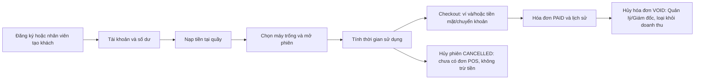
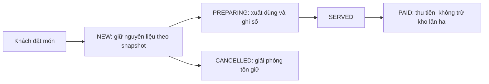

# Luồng nghiệp vụ hiện hành

Thao tác ghi đi theo chuỗi **giao diện → API/desktop adapter → service kiểm tra quyền và trạng thái → repository trong transaction → kết quả**; các thay đổi nhạy cảm được ghi audit theo nghiệp vụ. Các luồng bên dưới mô tả chế độ MySQL; demo chỉ mô phỏng một phần và mất dữ liệu khi khởi động lại.

## Vai trò

| Vai trò | Phạm vi chính |
|---|---|
| `ADMIN` | Quản trị tài khoản, xác thực và cấu hình kỹ thuật. Ở chính sách `separated`, ADMIN không kế thừa quyền điều hành kinh doanh. |
| `DIRECTOR` | Điều hành toàn chuỗi, xem báo cáo, quản lý chính sách kinh doanh/nhân sự và phê duyệt trong phạm vi được cấp; không làm thu ngân hằng ngày. |
| `MANAGER` | Điều hành cơ sở được phân công, duyệt chênh lệch, kiểm kê và vận hành. |
| `STAFF` | Khách hàng, máy, nạp tiền, thanh toán, đơn POS và ca của mình theo quyền cụ thể. |
| `KITCHEN` | Xem, chuẩn bị và phục vụ đơn; không quản lý kho hoặc thu tiền. |
| `INVENTORY` | Xem/nhập/xuất/kiểm kê kho, đề nghị và nhận hàng; không thu tiền POS. |
| Khách hàng | Tài khoản của chính mình qua `/customer`; không dùng API quản trị. |

Ma trận quyền chi tiết nằm trong `src/cyberhub_manager/domain/policies.py`; các API kiểm tra lại actor/cửa hàng, không dựa vào việc menu có hiển thị hay không.

## Khách hàng, máy và thanh toán

`CustomerService`, `WalletService`, `MachineService`, `SessionService` và `ReportService` xử lý các bước này. Checkout tính lại số thiếu trong transaction; hóa đơn, tài khoản (`account_transactions` + `session_transactions`) và phiên phải cùng commit hoặc cùng rollback. `SessionService.cancel_session` cho phép hủy phiên `ACTIVE` (chuyển sang `CANCELLED`, trả máy về `AVAILABLE`, không trừ tiền và không lập hóa đơn) nhưng bị chặn nếu phiên đã phát sinh đơn POS (`menu_orders`). `ReportService.void_invoice` chỉ cho phép quản trị kinh doanh (`DIRECTOR`/`MANAGER`, hoặc `ADMIN` ở chế độ `legacy`) chuyển hóa đơn `PAID` → `VOID` kèm audit và tự động loại khỏi doanh thu cũng như điểm thành viên. Khách xem máy trống, số dư, lịch sử và ưu đãi trên portal.

## POS và tồn kho

Đơn `NEW` có thời hạn giữ; việc hủy/hoàn sau phục vụ đi qua hồ sơ đảo và phê duyệt, không sửa đơn hoặc tồn bằng tay. Phiếu kiểm kê, nhập/xuất và thông báo khách có ledger/sự kiện riêng. Xem [quy tắc POS và kho](../features/POS_INVENTORY_LIFECYCLE.md) và `application/services/menu_*`, `infrastructure/repositories/menu_repository.py`, `infrastructure/repositories/inventory_repository.py`.

## Ca/két, sự cố và mua hàng

| Nghiệp vụ | Vòng đời | Nơi xử lý |
|---|---|---|
| Ca và két | Mở ca → ghi thu/chi theo phương thức → kiểm đếm → duyệt chênh lệch nếu có → đóng ca | `application/services/cash_shift_service.py`, migration `021` |
| Sự cố máy | Báo → phân công → sửa/chờ linh kiện → hoàn thành → nghiệm thu → mở lại máy | `application/services/maintenance_service.py`, migration `022` |
| Mua hàng | Đề nghị → duyệt → đơn mua → nhận hàng → ghi tồn/công nợ → thanh toán | `application/services/procurement_service.py`, migration `023` |

Các nghiệp vụ này chỉ chạy trên MySQL. Người tạo không tự duyệt các bước cần maker-checker. Xem [quy tắc vận hành](../features/OPERATIONS.md).

## Tương tác khách hàng và phân tích

- **Game, quảng cáo, voucher:** `GameService`, `AdService`, `VoucherService` xử lý lượt chơi/thưởng; đối tác thương mại đi qua hợp đồng, chiến dịch, event xác minh và đối soát tại `CommercialService`. Game ngoài không được gọi API cộng xu trực tiếp. Xem [đối tác game/quảng cáo](../features/COMMERCIAL_PARTNERS.md).
- **Trợ lý:** `infrastructure/ai/` nạp tài liệu được duyệt theo vai trò từ `docs/knowledge-base/`, tạo chỉ mục và gọi Gemini khi bật. Câu trả lời không thực hiện nạp tiền, thanh toán hay thao tác kho. Xem [RAG](../guides/RAG_5A_RUNBOOK.md).
- **Dự báo:** `scripts/run_forecasting.py` huấn luyện offline từ dữ liệu demo hoặc MySQL, xuất artifact 7/30 ngày; `presentation/web/forecasting_routes.py` yêu cầu quyền `VIEW_REVENUE` (DIRECTOR/MANAGER trong chính sách tách quyền; ADMIN chỉ còn quyền này ở chế độ legacy). Dữ liệu mô phỏng được gắn `is_simulated=true`. Xem [dự báo](../features/FORECASTING.md).
