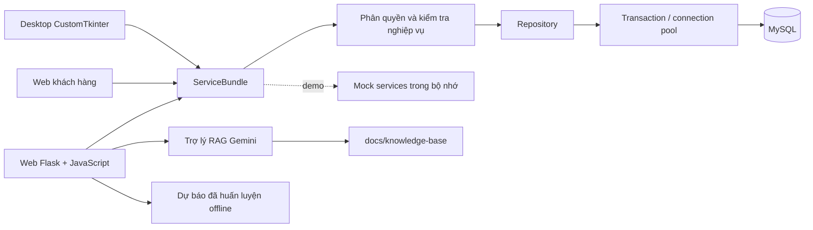

# Kiến trúc hiện hành

CyberHub dùng layered architecture gồm bốn tầng. Desktop CustomTkinter và web Flask dùng chung Application và Domain. Các phụ thuộc được kiểm tra bằng AST trong `tests/unit/test_layered_architecture.py`, bao gồm cả import nằm trong hàm.

```text
src/cyberhub_manager/
├── presentation/          # Flask routes, HTML/CSS/JS, desktop widgets
│   ├── web/
│   ├── desktop/
│   └── desktop_app.py
├── application/           # Use cases, quyền truy cập, điều phối transaction
│   ├── services/          # POS, kho, ca, mua hàng, nhân sự…
│   │   ├── forecasting/   # Dữ liệu mô hình, train/evaluate/predict
│   │   └── mocks/         # Test doubles và kịch bản demo theo hợp đồng service
│   ├── ai/                # Retrieval, prompts, orchestration RAG
│   └── runtime.py         # Startup và chuyển lỗi cho presentation
├── infrastructure/        # SQL, MySQL pool, Gemini, SQLite, bcrypt, Pillow
│   ├── repositories/
│   ├── database/
│   └── ai/
└── domain/                # Entity, value object, DTO, quy tắc, lỗi, hợp đồng AI
```

Đây là layered architecture cổ điển: Application được phép dùng Infrastructure. Dependency inversion toàn bộ repository chưa phải quy ước của mô hình này. `app.py` và `web/` ở gốc chỉ là entry point tương thích, không chứa nghiệp vụ.



## Điểm vào và trách nhiệm

| Lớp | Vị trí | Trách nhiệm |
|---|---|---|
| Presentation | `presentation/web/`, `presentation/desktop/` | Session, CSRF, JSON, hiển thị; gọi Application và dùng DTO/enum Domain. Không gọi Infrastructure hoặc chạy SQL. |
| Application | `application/services/`, `application/ai/` | Kiểm tra actor/cơ sở, thực thi use case, điều phối transaction và adapter. Không import Flask/Tk hoặc chạy SQL. |
| Infrastructure | `infrastructure/repositories/`, `infrastructure/database/`, `infrastructure/ai/` | Persistence, provider và thư viện kỹ thuật. Không import Application hoặc Presentation. Trả DTO Domain hoặc dữ liệu cơ bản. |
| Domain | `domain/` | Quy tắc nghiệp vụ và kiểu dữ liệu. Không import ba tầng còn lại hoặc framework/vendor lưu trữ. |

Service nhận repository và transaction qua constructor để kiểm thử. Composition hiện nằm trong `application/services/bootstrap.py`; các constructor mặc định vẫn cung cấp adapter thật. Không khởi tạo connection/model/network khi chỉ import Domain.

SQL tổng hợp dự báo đặt tại `infrastructure/repositories/forecast_repository.py`; adapter sklearn tại `infrastructure/forecast_models.py`. Quy tắc chọn mô hình và time split ở Application. Kiểu chính sách và provider protocol RAG ở `domain/ai/`; HTTP Gemini, tải tài liệu và SQLite ở Infrastructure.

Entry point mới: `python -m cyberhub_manager.presentation.web --port 8000`. Lệnh cũ `python -m cyberhub_manager.web --port 8000` vẫn hoạt động. Static files, templates, font và logo đóng gói theo package Presentation mới. Artifact dự báo đã lưu bằng module cũ được đọc qua unpickler tương thích; chỉ dùng artifact tin cậy do dự án sinh.

## Ranh giới cần giữ khi sửa code

- Chỉ service quyết định có được đổi trạng thái hay ghi tiền/kho. UI ẩn nút không thay thế kiểm tra quyền ở backend. Quyền nghiệp vụ tập trung trong `domain/p1.py`.
- Với MySQL, service mở transaction, repository dùng cùng connection, thành công thì commit và lỗi thì rollback. Không commit trong repository.
- Demo có dữ liệu theo phiên và không phải môi trường nghiệm thu transaction hay lưu trữ bền vững. Các luồng kho, ca/két, bảo trì, mua hàng cần kiểm tra trên MySQL.
- Trợ lý chỉ đọc tri thức được phép tại `docs/knowledge-base/`. Dự báo đọc artifact trong `runtime/forecasting/`; web không huấn luyện model trong HTTP request.

Xem [các luồng nghiệp vụ](BUSINESS_FLOWS.md) để theo một thao tác từ người dùng đến dữ liệu và [hướng dẫn phát triển](../guides/DEVELOPMENT.md) để thêm tính năng.
