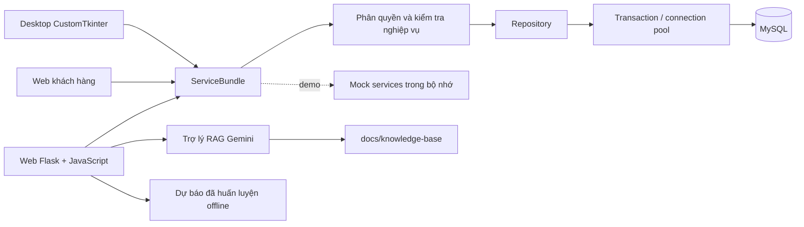

# Kiến trúc hiện hành

CyberHub có hai giao diện: desktop CustomTkinter và web Flask. Cả hai dùng các service nghiệp vụ trong `src/cyberhub_manager/services/`. Web có cổng nhân viên tại `/` và cổng khách hàng tại `/customer`; frontend gọi API trong `web/`. Demo dùng service và dữ liệu trong bộ nhớ; chế độ MySQL dùng repository và transaction thật.

## Điểm vào và trách nhiệm

| Lớp | Vị trí | Trách nhiệm |
|---|---|---|
| Web | `web/application.py`, `web/operations_routes.py`, `web/feature_routes.py`, `web/business_routes.py`, `web/forecasting_routes.py` | Session, CSRF, JSON và chuyển yêu cầu vào service. Không tự tính tiền hoặc sửa kho. |
| Desktop | `ui/`, `app.py` | Hiển thị và gọi service qua cùng hợp đồng. |
| Composition | `services/bootstrap.py`, `web/demo.py` | Ghép service thật hoặc tạo workspace demo. |
| Nghiệp vụ | `services/`, `domain/` | Kiểm tra actor, cửa hàng, trạng thái, số tiền và quyền. |
| Dữ liệu | `repositories/`, `database/transaction.py` | Truy vấn MySQL trong transaction do service điều khiển. |
| Cấu hình | `config.py`, `web/config.py`, `.env.example` | Kết nối, chế độ chạy, khóa phiên và các cờ tùy chọn. |
| AI | `ai/`, `services/forecasting/` | RAG theo nguồn được duyệt và dự báo offline; độc lập với giao dịch tiền/kho. |

## Ranh giới cần giữ khi sửa code

- Chỉ service quyết định có được đổi trạng thái hay ghi tiền/kho. UI ẩn nút không thay thế kiểm tra quyền ở backend. Quyền nghiệp vụ tập trung trong `domain/p1.py`.
- Với MySQL, service mở transaction, repository dùng cùng connection, thành công thì commit và lỗi thì rollback. Không commit trong repository.
- Demo có dữ liệu theo phiên và không phải môi trường nghiệm thu transaction hay lưu trữ bền vững. Các luồng kho, ca/két, bảo trì, mua hàng cần kiểm tra trên MySQL.
- Trợ lý chỉ đọc tri thức được phép tại `docs/knowledge-base/`. Dự báo đọc artifact trong `runtime/forecasting/`; web không huấn luyện model trong HTTP request.

Xem [các luồng nghiệp vụ](BUSINESS_FLOWS.md) để theo một thao tác từ người dùng đến dữ liệu và [hướng dẫn phát triển](../guides/DEVELOPMENT.md) để thêm tính năng.
