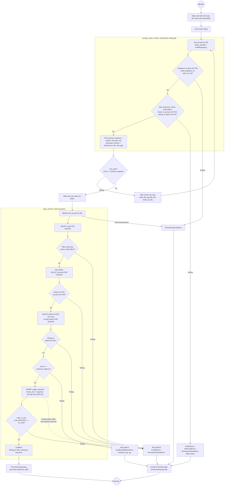
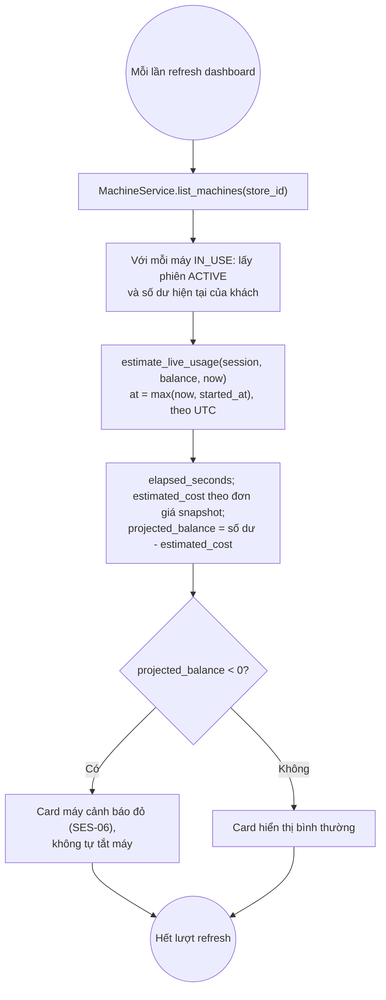

# Activity Diagrams

<!-- Linh: còn bổ sung luồng nạp tiền (LI-04) và checkout (LI-07). -->

## 1. Mở phiên sử dụng máy (LI-06)

Căn cứ: SES-01 đến SES-06 trong `docs/01_REQUIREMENTS.md`, `SessionServiceProtocol`
trong `services/contracts.py`. Preview chỉ đọc; mở phiên khóa dữ liệu bằng
`SELECT ... FOR UPDATE` và chạy trọn trong một transaction.

**Điểm chính**

| Điểm | Cách đảm bảo |
|---|---|
| Không tin role/store từ UI | Mỗi lần gọi đều đọc lại actor bằng `AuthRepository.get_active_session_by_id`; role, store khai báo khác DB thì bị từ chối |
| Preview không ghi | `preview_open` dùng `lock=False`, không gọi `create` hay `mark_in_use` |
| Chống mở trùng (SES-03) | Khóa theo thứ tự máy -> account -> phiên; request sau phải chờ rồi đọc thấy máy `IN_USE`. Unique index `uq_usage_sessions_active_machine/customer` là lưới an toàn cuối |
| Insert phiên và đổi máy cùng thành công hoặc cùng thất bại | Mọi lỗi sau `INSERT` thoát khỏi `with transaction()` nên rollback cả phiên |
| Snapshot đơn giá (SES-02) | `usage_sessions.hourly_rate` chép từ máy lúc mở; đổi giá máy sau đó không ảnh hưởng |

## 2. Live estimate trên dashboard (SES-05, SES-06)

Không thêm method vào `SessionServiceProtocol`; dashboard lấy qua
`MachineService.list_machines()`, dùng chung `estimate_live_usage()` ở domain với
công thức tính phí checkout (SES-07).

