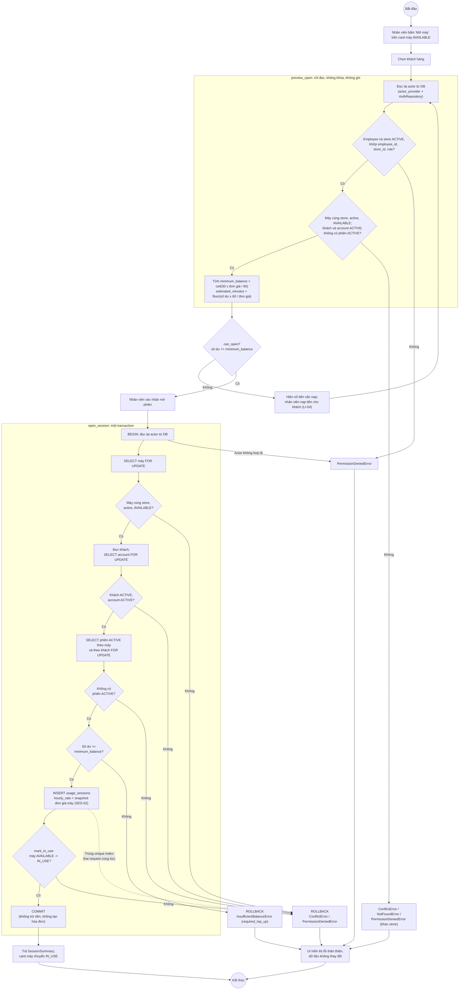
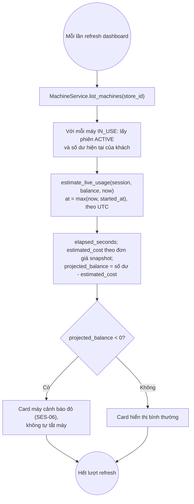
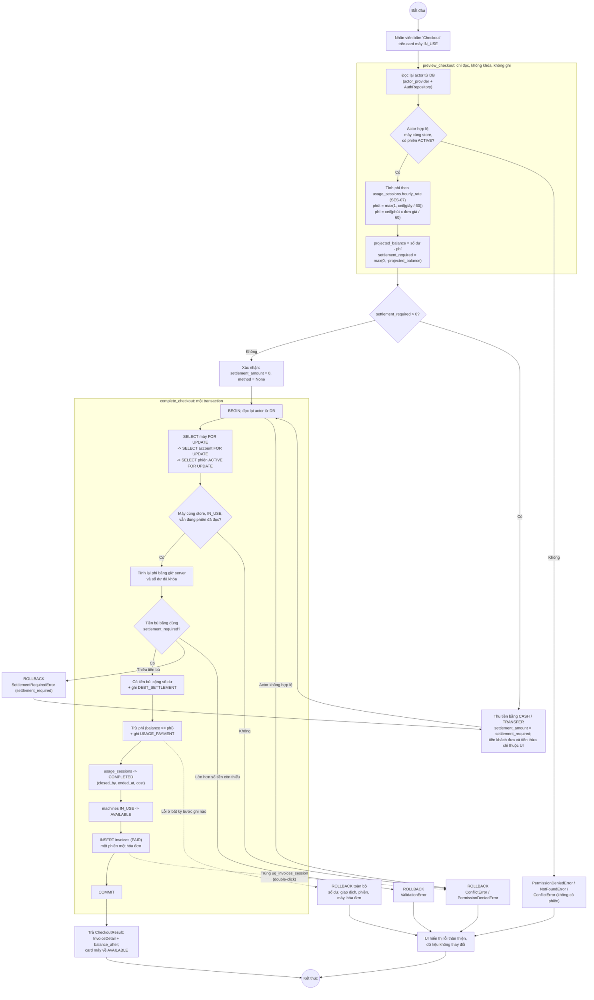

# Activity Diagrams

<!-- Linh: còn bổ sung luồng nạp tiền (LI-04). -->

## 1. Mở phiên sử dụng máy (LI-06)

Căn cứ: SES-01 đến SES-06 trong `docs/01_REQUIREMENTS.md`, `SessionServiceProtocol`
trong `services/contracts.py`. Preview chỉ đọc; mở phiên khóa dữ liệu bằng
`SELECT ... FOR UPDATE` và chạy trọn trong một transaction.

**Điểm chính**

| Điểm | Cách đảm bảo |
|---|---|
| Không tin role/store từ UI | Mỗi lần gọi đều đọc lại actor bằng `AuthRepository.get_active_session_by_id`; role, store khai báo khác DB thì bị từ chối |
| Preview không ghi | `preview_open` dùng `lock=False`, không gọi `create` hay `mark_in_use` |
| Chống mở trùng (SES-03) | Khóa theo thứ tự máy -> account -> phiên; request sau phải chờ rồi đọc thấy máy `IN_USE`. Unique index `uq_usage_sessions_active_machine/customer` là lưới an toàn cuối |
| Insert phiên và đổi máy cùng thành công hoặc cùng thất bại | Mọi lỗi sau `INSERT` thoát khỏi `with transaction()` nên rollback cả phiên |
| Snapshot đơn giá (SES-02) | `usage_sessions.hourly_rate` chép từ máy lúc mở; đổi giá máy sau đó không ảnh hưởng |

## 2. Live estimate trên dashboard (SES-05, SES-06)

Không thêm method vào `SessionServiceProtocol`; dashboard lấy qua
`MachineService.list_machines()`, dùng chung `estimate_live_usage()` ở domain với
công thức tính phí checkout (SES-07).

## 3. Checkout và tạo hóa đơn (LI-07)

Căn cứ: SES-07 đến SES-09 và INV-01 trong `docs/01_REQUIREMENTS.md`. Preview chỉ
đọc. Hoàn tất checkout tính lại phí bằng giờ server và số dư đã khóa; trừ số dư,
ghi giao dịch, đóng phiên, trả máy và tạo hóa đơn cùng commit hoặc cùng rollback.

**Điểm chính**

| Điểm | Cách đảm bảo |
|---|---|
| Không tin số liệu từ UI | Contract không nhận phí, thời lượng hay số dư; `ended_at` lấy từ đồng hồ server, số dư đọc sau khi khóa |
| Preview không ghi | `preview_checkout` đọc không khóa, không gọi repository ghi |
| Số dư không âm | Cộng tiền bù trước, `debit_balance` có `WHERE balance >= amount` |
| Một phiên một hóa đơn, chống double-click | Request sau chờ khóa máy rồi thấy máy `AVAILABLE`; `UPDATE ... WHERE status = 'ACTIVE'`; unique `uq_invoices_session` là lưới an toàn cuối |
| Nguyên tử (SES-09) | Mọi lệnh ghi nằm trong `with transaction()`; repository trả `False` hoặc ném lỗi đều làm rollback cả năm nhóm dữ liệu |
| Thứ tự khóa | Máy -> account -> phiên, giống mở phiên, để hai thao tác không khóa chéo nhau |
| Tiền bù không phải tiền khách đưa | `settlement_amount` phải bằng đúng `settlement_required`; tiền khách đưa và tiền thừa chỉ được UI dùng để hiển thị, phần dư muốn nạp vào ví phải gọi luồng `top_up` riêng |

