# Class Diagram

Ký hiệu `+` là thành viên public. Dấu `?` sau kiểu dữ liệu biểu thị
giá trị nullable (`T | None` trong Python). Entity và DTO có thuộc tính
public theo contract; nghiệp vụ điều phối được công khai qua các service
interface.

```mermaid
classDiagram
    direction LR

    class Store {
        +int id
        +str code
        +str name
        +str address
        +StoreStatus status
        +datetime created_at
        +datetime updated_at
    }

    class Employee {
        +int id
        +str code
        +str full_name
        +int store_id
        +str username
        +Role role
        +EmployeeStatus status
    }

    class Account {
        +int id
        +str code
        +int customer_id
        +str username
        +int balance
        +AccountStatus status
    }

    class Customer {
        +int id
        +str code
        +str full_name
        +str phone
        +CustomerStatus status
        +Account account
    }

    class Machine {
        +int id
        +str code
        +int store_id
        +str name
        +MachineStatus status
        +int hourly_rate
        +bool is_active
        +datetime updated_at
    }

    class UsageSession {
        +int id
        +str code
        +int customer_id
        +int machine_id
        +int opened_by
        +int? closed_by
        +datetime started_at
        +datetime? ended_at
        +int hourly_rate
        +int? cost
        +SessionStatus status
    }

    class AccountTransaction {
        +int id
        +str code
        +int account_id
        +int employee_id
        +int? session_id
        +TransactionType type
        +int amount
        +PaymentMethod method
        +datetime created_at
    }

    class Invoice {
        +int id
        +str code
        +int session_id
        +int customer_id
        +int employee_id
        +int store_id
        +int usage_cost
        +int settlement_amount
        +int total_amount
        +InvoiceStatus status
        +datetime created_at
    }

    class EmployeeSession {
        <<frozen DTO>>
        +int employee_id
        +str employee_code
        +str full_name
        +str username
        +int store_id
        +str store_code
        +str store_name
        +Role role
    }

    class CustomerSummary {
        <<frozen DTO>>
        +int customer_id
        +str customer_code
        +str full_name
        +str phone
        +int account_id
        +str username
        +int balance
        +CustomerStatus customer_status
        +AccountStatus account_status
    }

    class SessionSummary {
        <<frozen DTO>>
        +int session_id
        +str session_code
        +int customer_id
        +str customer_code
        +str customer_name
        +int machine_id
        +str machine_code
        +str machine_name
        +datetime started_at
        +int hourly_rate
        +SessionStatus status
    }

    class ActiveSessionSummary {
        <<frozen DTO>>
        +SessionSummary session
        +int account_balance
        +int elapsed_seconds
        +int estimated_cost
        +int projected_balance
        +datetime as_of
    }

    class MachineSummary {
        <<frozen DTO>>
        +int machine_id
        +str machine_code
        +int store_id
        +str name
        +MachineStatus status
        +int hourly_rate
        +bool is_active
        +datetime updated_at
        +ActiveSessionSummary? active_session
    }

    class TransactionSummary {
        <<frozen DTO>>
        +int transaction_id
        +str transaction_code
        +int account_id
        +int? session_id
        +TransactionType type
        +int amount
        +PaymentMethod method
        +int employee_id
        +str employee_name
        +datetime created_at
    }

    class TopUpResult {
        <<frozen DTO>>
        +int customer_id
        +int account_id
        +int balance_before
        +int balance_after
        +TransactionSummary transaction
    }

    class OpenSessionPreview {
        <<frozen DTO>>
        +int customer_id
        +int machine_id
        +int balance
        +int hourly_rate
        +int minimum_balance
        +int estimated_minutes
        +bool can_open
        +str? blocked_reason
        +datetime as_of
    }

    class CheckoutPreview {
        <<frozen DTO>>
        +SessionSummary session
        +datetime calculated_at
        +int elapsed_seconds
        +int billed_minutes
        +int usage_cost
        +int balance_before
        +int projected_balance
        +int settlement_required
    }

    class InvoiceSummary {
        <<frozen DTO>>
        +int invoice_id
        +str invoice_code
        +int session_id
        +int customer_id
        +str customer_name
        +int employee_id
        +str employee_name
        +int store_id
        +str store_name
        +int usage_cost
        +int settlement_amount
        +int total_amount
        +InvoiceStatus status
        +datetime created_at
    }

    class InvoiceDetail {
        <<frozen DTO>>
        +InvoiceSummary invoice
        +SessionSummary session
        +datetime ended_at
        +int billed_minutes
    }

    class CheckoutResult {
        <<frozen DTO>>
        +InvoiceDetail invoice
        +int balance_after
    }

    class DailyRevenue {
        <<frozen DTO>>
        +date date
        +int invoice_count
        +int revenue
    }

    class MachineArchiveResult {
        <<frozen DTO>>
        +int machine_id
        +MachineArchiveAction action
    }

    class InvoiceFilters {
        <<frozen DTO>>
        +date? date_from
        +date? date_to
        +str keyword
        +int? customer_id
        +InvoiceStatus? status
    }

    class AuthServiceProtocol {
        <<interface>>
        +login(str username, str password) EmployeeSession
    }

    class CustomerServiceProtocol {
        <<interface>>
        +create_customer(str full_name, str phone, str username, str password) Customer
        +get_customer(int customer_id) Customer
        +search_customers(str keyword) list~CustomerSummary~
        +update_customer(int customer_id, str full_name, str phone) Customer
        +set_customer_status(int customer_id, CustomerStatus status, EmployeeSession actor) Customer
    }

    class WalletServiceProtocol {
        <<interface>>
        +top_up(int customer_id, int amount, PaymentMethod method, int employee_id) TopUpResult
        +get_history(int customer_id) list~TransactionSummary~
    }

    class MachineServiceProtocol {
        <<interface>>
        +list_machines(int store_id) list~MachineSummary~
        +create_machine(str code, int store_id, str name, int hourly_rate, EmployeeSession actor) Machine
        +update_machine(int machine_id, str name, int hourly_rate, EmployeeSession actor) Machine
        +set_maintenance(int machine_id, bool enabled, EmployeeSession actor) Machine
        +archive_machine(int machine_id, EmployeeSession actor) MachineArchiveResult
    }

    class SessionServiceProtocol {
        <<interface>>
        +preview_open(int customer_id, int machine_id, EmployeeSession actor) OpenSessionPreview
        +open_session(int customer_id, int machine_id, EmployeeSession actor) SessionSummary
        +preview_checkout(int machine_id, datetime current_time) CheckoutPreview
        +complete_checkout(int machine_id, EmployeeSession actor, int settlement_amount, PaymentMethod? method) CheckoutResult
    }

    class ReportServiceProtocol {
        <<interface>>
        +list_invoices(int store_id, InvoiceFilters filters) list~InvoiceSummary~
        +get_invoice(int invoice_id) InvoiceDetail
        +daily_revenue(int store_id, date date_from, date date_to) list~DailyRevenue~
    }

    class ServiceBundle {
        +AuthServiceProtocol auth
        +CustomerServiceProtocol customers
        +WalletServiceProtocol wallet
        +MachineServiceProtocol machines
        +SessionServiceProtocol sessions
        +ReportServiceProtocol reports
    }

    Store "1" --> "*" Employee : employs
    Store "1" --> "*" Machine : owns
    Customer "1" *-- "1" Account : owns
    Customer "1" --> "*" UsageSession : starts
    Machine "1" --> "*" UsageSession : serves
    UsageSession "1" --> "0..1" Invoice : checkout creates
    Account "1" --> "*" AccountTransaction : contains

    MachineSummary "1" *-- "0..1" ActiveSessionSummary
    ActiveSessionSummary "1" *-- "1" SessionSummary
    TopUpResult "1" *-- "1" TransactionSummary
    CheckoutPreview "1" *-- "1" SessionSummary
    InvoiceDetail "1" *-- "1" InvoiceSummary
    InvoiceDetail "1" *-- "1" SessionSummary
    CheckoutResult "1" *-- "1" InvoiceDetail

    ServiceBundle o-- AuthServiceProtocol
    ServiceBundle o-- CustomerServiceProtocol
    ServiceBundle o-- WalletServiceProtocol
    ServiceBundle o-- MachineServiceProtocol
    ServiceBundle o-- SessionServiceProtocol
    ServiceBundle o-- ReportServiceProtocol
```

