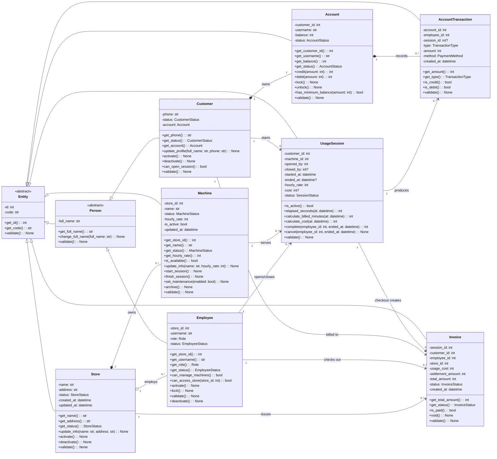

# Class Diagram - CyberHub Manager

Tài liệu này mô tả thiết kế hướng đối tượng đích của hệ thống. Sơ đồ được tách
thành nhiều phần để có thể hiện đầy đủ thuộc tính, phương thức và quan hệ mà vẫn
dễ đọc.

## Quy ước UML

- `+`: public, `#`: protected, `-`: private.
- Thuộc tính kết thúc bằng `?` có thể nhận `None`.
- `*--`: composition, `o--`: aggregation, `-->`: association.
- `<|--`: inheritance, `<|..`: implements/realization.
- `<<abstract>>`: lớp trừu tượng, `<<interface>>`: giao diện,
  `<<frozen DTO>>`: đối tượng truyền dữ liệu bất biến.

## Bốn tính chất OOP được thể hiện

| Tính chất | Thành phần thể hiện trong thiết kế |
|---|---|
| **Đóng gói (Encapsulation)** | Trạng thái của entity là `private/protected`; việc đổi số dư, trạng thái máy, phiên và hóa đơn phải đi qua method nghiệp vụ. |
| **Kế thừa (Inheritance)** | `Employee` và `Customer` kế thừa `Person`; các lỗi nghiệp vụ kế thừa `ApplicationError`. |
| **Trừu tượng (Abstraction)** | `Entity`, `Person` và các `ServiceProtocol` định nghĩa contract, che giấu chi tiết triển khai. |
| **Đa hình (Polymorphism)** | Các entity override `validate()` theo quy tắc riêng; các exception con có thể được xử lý thông qua kiểu cha `ApplicationError`. |

## 1. Domain model và đóng gói



Điểm đóng gói quan trọng: UI hoặc repository không được gán trực tiếp
`Account.balance`, `Machine.status`, `UsageSession.status` hay
`Invoice.status`. Mọi thay đổi phải gọi method nghiệp vụ tương ứng để bảo toàn
invariant.

## 2. Service interface và abstraction
Các `ServiceProtocol` và `ServiceBundle` dưới đây là contract đã được chốt cho
LI02, chưa phải implementation có sẵn trong code LI01. Concrete service sẽ
implements các interface này ở những task tiếp theo.

```mermaid
classDiagram
    direction TB

    class AuthServiceProtocol {
        <<interface>>
        +login(username: str, password: str): EmployeeSession
    }
    class CustomerServiceProtocol {
        <<interface>>
        +create_customer(full_name: str, phone: str, username: str, password: str): Customer
        +get_customer(customer_id: int): Customer
        +search_customers(keyword: str): list~CustomerSummary~
        +update_customer(customer_id: int, full_name: str, phone: str): Customer
        +set_customer_status(customer_id: int, status: CustomerStatus, actor: EmployeeSession): Customer
    }
    class WalletServiceProtocol {
        <<interface>>
        +top_up(customer_id: int, amount: int, method: PaymentMethod, employee_id: int): TopUpResult
        +get_history(customer_id: int): list~TransactionSummary~
    }
    class MachineServiceProtocol {
        <<interface>>
        +list_machines(store_id: int): list~MachineSummary~
        +create_machine(code: str, store_id: int, name: str, hourly_rate: int, actor: EmployeeSession): Machine
        +update_machine(machine_id: int, name: str, hourly_rate: int, actor: EmployeeSession): Machine
        +set_maintenance(machine_id: int, enabled: bool, actor: EmployeeSession): Machine
        +archive_machine(machine_id: int, actor: EmployeeSession): MachineArchiveResult
    }
    class SessionServiceProtocol {
        <<interface>>
        +preview_open(customer_id: int, machine_id: int, actor: EmployeeSession): OpenSessionPreview
        +open_session(customer_id: int, machine_id: int, actor: EmployeeSession): SessionSummary
        +preview_checkout(machine_id: int, current_time: datetime): CheckoutPreview
        +complete_checkout(machine_id: int, actor: EmployeeSession, settlement_amount: int, method: PaymentMethod?): CheckoutResult
    }
    class ReportServiceProtocol {
        <<interface>>
        +list_invoices(store_id: int, filters: InvoiceFilters): list~InvoiceSummary~
        +get_invoice(invoice_id: int): InvoiceDetail
        +daily_revenue(store_id: int, date_from: date, date_to: date): list~DailyRevenue~
    }

    class ServiceBundle {
    <<planned>>
    +auth: AuthServiceProtocol
    +customers: CustomerServiceProtocol
    +wallet: WalletServiceProtocol
    +machines: MachineServiceProtocol
    +sessions: SessionServiceProtocol
    +reports: ReportServiceProtocol
}
    ServiceBundle o-- AuthServiceProtocol
    ServiceBundle o-- CustomerServiceProtocol
    ServiceBundle o-- WalletServiceProtocol
    ServiceBundle o-- MachineServiceProtocol
    ServiceBundle o-- SessionServiceProtocol
    ServiceBundle o-- ReportServiceProtocol

```



## 3. DTO (các object trao đổi giữa service và UI)

Các DTO là `dataclass(frozen=True)`: toàn bộ thuộc tính chỉ đọc. Python tự sinh
`__init__`, `__repr__`, `__eq__` và `__hash__`; sơ đồ ghi `__init__()` đại diện
cho các method được sinh tự động này.

```mermaid
classDiagram
    direction LR

    class EmployeeSession {
        <<frozen DTO>>
        +employee_id: int {readOnly}
        +employee_code: str {readOnly}
        +full_name: str {readOnly}
        +username: str {readOnly}
        +store_id: int {readOnly}
        +store_code: str {readOnly}
        +store_name: str {readOnly}
        +role: Role {readOnly}
        +__init__(): EmployeeSession
    }
    class CustomerSummary {
        <<frozen DTO>>
        +customer_id: int {readOnly}
        +customer_code: str {readOnly}
        +full_name: str {readOnly}
        +phone: str {readOnly}
        +account_id: int {readOnly}
        +username: str {readOnly}
        +balance: int {readOnly}
        +customer_status: CustomerStatus {readOnly}
        +account_status: AccountStatus {readOnly}
        +__init__(): CustomerSummary
    }
    class SessionSummary {
        <<frozen DTO>>
        +session_id: int {readOnly}
        +session_code: str {readOnly}
        +customer_id: int {readOnly}
        +customer_code: str {readOnly}
        +customer_name: str {readOnly}
        +machine_id: int {readOnly}
        +machine_code: str {readOnly}
        +machine_name: str {readOnly}
        +started_at: datetime {readOnly}
        +hourly_rate: int {readOnly}
        +status: SessionStatus {readOnly}
        +__init__(): SessionSummary
    }
    class ActiveSessionSummary {
        <<frozen DTO>>
        +session: SessionSummary {readOnly}
        +account_balance: int {readOnly}
        +elapsed_seconds: int {readOnly}
        +estimated_cost: int {readOnly}
        +projected_balance: int {readOnly}
        +as_of: datetime {readOnly}
        +__init__(): ActiveSessionSummary
    }
    class MachineSummary {
        <<frozen DTO>>
        +machine_id: int {readOnly}
        +machine_code: str {readOnly}
        +store_id: int {readOnly}
        +name: str {readOnly}
        +status: MachineStatus {readOnly}
        +hourly_rate: int {readOnly}
        +is_active: bool {readOnly}
        +updated_at: datetime {readOnly}
        +active_session: ActiveSessionSummary? {readOnly}
        +__init__(): MachineSummary
    }
    class TransactionSummary {
        <<frozen DTO>>
        +transaction_id: int {readOnly}
        +transaction_code: str {readOnly}
        +account_id: int {readOnly}
        +session_id: int? {readOnly}
        +type: TransactionType {readOnly}
        +amount: int {readOnly}
        +method: PaymentMethod {readOnly}
        +employee_id: int {readOnly}
        +employee_name: str {readOnly}
        +created_at: datetime {readOnly}
        +__init__(): TransactionSummary
    }
    class TopUpResult {
        <<frozen DTO>>
        +customer_id: int {readOnly}
        +account_id: int {readOnly}
        +balance_before: int {readOnly}
        +balance_after: int {readOnly}
        +transaction: TransactionSummary {readOnly}
        +__init__(): TopUpResult
    }
    class OpenSessionPreview {
        <<frozen DTO>>
        +customer_id: int {readOnly}
        +machine_id: int {readOnly}
        +balance: int {readOnly}
        +hourly_rate: int {readOnly}
        +minimum_balance: int {readOnly}
        +estimated_minutes: int {readOnly}
        +can_open: bool {readOnly}
        +blocked_reason: str? {readOnly}
        +as_of: datetime {readOnly}
        +__init__(): OpenSessionPreview
    }
    class CheckoutPreview {
        <<frozen DTO>>
        +session: SessionSummary {readOnly}
        +calculated_at: datetime {readOnly}
        +elapsed_seconds: int {readOnly}
        +billed_minutes: int {readOnly}
        +usage_cost: int {readOnly}
        +balance_before: int {readOnly}
        +projected_balance: int {readOnly}
        +settlement_required: int {readOnly}
        +__init__(): CheckoutPreview
    }
    class InvoiceSummary {
        <<frozen DTO>>
        +invoice_id: int {readOnly}
        +invoice_code: str {readOnly}
        +session_id: int {readOnly}
        +customer_id: int {readOnly}
        +customer_name: str {readOnly}
        +employee_id: int {readOnly}
        +employee_name: str {readOnly}
        +store_id: int {readOnly}
        +store_name: str {readOnly}
        +usage_cost: int {readOnly}
        +settlement_amount: int {readOnly}
        +total_amount: int {readOnly}
        +status: InvoiceStatus {readOnly}
        +created_at: datetime {readOnly}
        +__init__(): InvoiceSummary
    }
    class InvoiceDetail {
        <<frozen DTO>>
        +invoice: InvoiceSummary {readOnly}
        +session: SessionSummary {readOnly}
        +ended_at: datetime {readOnly}
        +billed_minutes: int {readOnly}
        +__init__(): InvoiceDetail
    }
    class CheckoutResult {
        <<frozen DTO>>
        +invoice: InvoiceDetail {readOnly}
        +balance_after: int {readOnly}
        +__init__(): CheckoutResult
    }
    class DailyRevenue {
        <<frozen DTO>>
        +date: date {readOnly}
        +invoice_count: int {readOnly}
        +revenue: int {readOnly}
        +__init__(): DailyRevenue
    }
    class MachineArchiveResult {
        <<frozen DTO>>
        +machine_id: int {readOnly}
        +action: MachineArchiveAction {readOnly}
        +__init__(): MachineArchiveResult
    }
    class InvoiceFilters {
        <<frozen DTO>>
        +date_from: date? {readOnly}
        +date_to: date? {readOnly}
        +keyword: str {readOnly}
        +customer_id: int? {readOnly}
        +status: InvoiceStatus? {readOnly}
        +__init__(): InvoiceFilters
    }

    MachineSummary "1" *-- "0..1" ActiveSessionSummary
    ActiveSessionSummary "1" *-- "1" SessionSummary
    TopUpResult "1" *-- "1" TransactionSummary
    CheckoutPreview "1" *-- "1" SessionSummary
    InvoiceDetail "1" *-- "1" InvoiceSummary
    InvoiceDetail "1" *-- "1" SessionSummary
    CheckoutResult "1" *-- "1" InvoiceDetail
```

## 4. Exception hierarchy - kế thừa và đa hình

Mọi lỗi nghiệp vụ đều có thể được UI bắt dưới kiểu cha `ApplicationError`, nhưng
vẫn giữ `code` và thông điệp riêng của từng lớp con.

```mermaid
classDiagram
    direction TB

    class Exception
    class ApplicationError {
        +code: str
        +message: str
        +field_errors: dict
        +details: dict
        +__init__(code: str, message: str, field_errors: dict?, details: dict?): None
    }
    class ValidationError {
        +__init__(message: str, field_errors: dict?, details: dict?): None
    }
    class AuthenticationError {
        +__init__(message: str, field_errors: dict?, details: dict?): None
    }
    class NotFoundError {
        +__init__(message: str, field_errors: dict?, details: dict?): None
    }
    class ConflictError {
        +__init__(message: str, field_errors: dict?, details: dict?): None
    }
    class PermissionDeniedError {
        +__init__(message: str, field_errors: dict?, details: dict?): None
    }
    class InsufficientBalanceError {
        +__init__(message: str, field_errors: dict?, details: dict?): None
    }
    class SettlementRequiredError {
        +__init__(message: str, field_errors: dict?, details: dict?): None
    }
    class ServiceUnavailableError {
        +__init__(message: str, field_errors: dict?, details: dict?): None
    }

    Exception <|-- ApplicationError
    ApplicationError <|-- ValidationError
    ApplicationError <|-- AuthenticationError
    ApplicationError <|-- NotFoundError
    ApplicationError <|-- ConflictError
    ApplicationError <|-- PermissionDeniedError
    ApplicationError <|-- InsufficientBalanceError
    ApplicationError <|-- SettlementRequiredError
    ApplicationError <|-- ServiceUnavailableError
```



## 5. Enum dùng trong các class

| Enum | Giá trị |
|---|---|
| `Role` | `ADMIN`, `MANAGER`, `STAFF` |
| `StoreStatus` | `ACTIVE`, `INACTIVE` |
| `EmployeeStatus` | `ACTIVE`, `INACTIVE`, `LOCKED` |
| `CustomerStatus` | `ACTIVE`, `INACTIVE` |
| `AccountStatus` | `ACTIVE`, `LOCKED` |
| `MachineStatus` | `AVAILABLE`, `IN_USE`, `MAINTENANCE` |
| `SessionStatus` | `ACTIVE`, `COMPLETED`, `CANCELLED` |
| `TransactionType` | `TOP_UP`, `PROMOTION`, `USAGE_PAYMENT`, `DEBT_SETTLEMENT` |
| `PaymentMethod` | `CASH`, `TRANSFER`, `ACCOUNT_BALANCE`, `PROMOTION` |
| `InvoiceStatus` | `PAID`, `VOID` |
| `MachineArchiveAction` | `DELETED`, `ARCHIVED` |

## 6. Đối chiếu nhanh trách nhiệm

| Class/nhóm | Trách nhiệm chính |
|---|---|
| Entity | Giữ identity chung và contract `validate()`. |
| Store, Person, Employee, Customer | Thông tin tổ chức và người dùng. |
| Account, AccountTransaction | Số dư và lịch sử biến động tiền. |
| Machine, UsageSession | Trạng thái máy, thời lượng và tính phí. |
| Invoice | Kết quả checkout, không xóa cứng. |
| Service | Điều phối use case và transaction. |
| Repository | Ẩn SQL/cơ chế lưu trữ khỏi service. |
| DTO | Snapshot bất biến dùng giữa service và UI. |
| ApplicationError | Contract lỗi thống nhất cho UI. |
