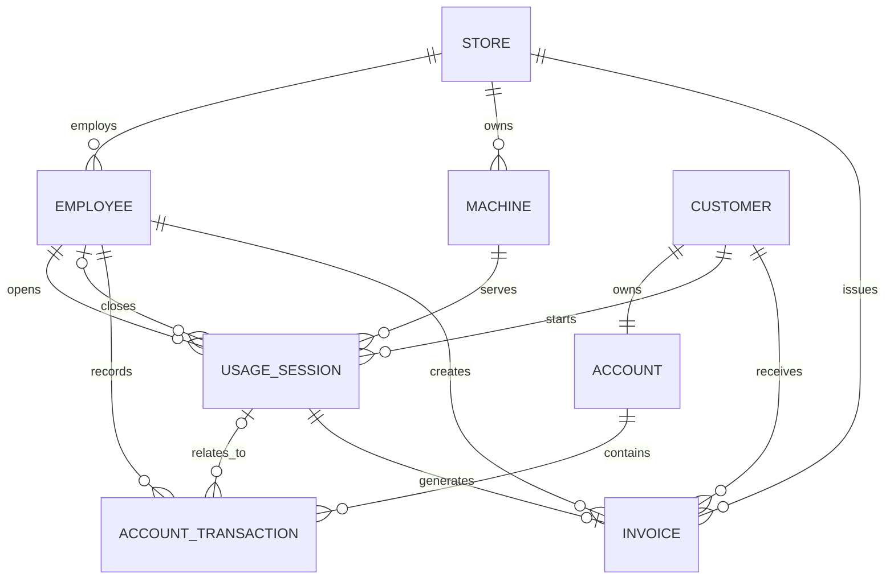

# Mô hình quan niệm — Conceptual ERD

## 1. Mục tiêu

Mô hình quan niệm mô tả các đối tượng nghiệp vụ và quan hệ giữa chúng, không phụ thuộc MySQL, kiểu dữ liệu, index hoặc cách cài đặt khóa ngoại.

## 2. Thực thể nghiệp vụ

| Thực thể | Ý nghĩa |
|---|---|
| `STORE` | Cửa hàng net được quản lý trong hệ thống |
| `EMPLOYEE` | Nhân viên đăng nhập và thực hiện nghiệp vụ |
| `CUSTOMER` | Khách hàng sử dụng dịch vụ |
| `ACCOUNT` | Tài khoản đăng nhập và số dư của khách hàng |
| `MACHINE` | Máy tính thuộc một cửa hàng |
| `USAGE_SESSION` | Một lần khách hàng sử dụng máy |
| `ACCOUNT_TRANSACTION` | Một lần thay đổi số dư tài khoản |
| `INVOICE` | Hóa đơn được tạo khi checkout thành công |

## 3. Sơ đồ quan niệm

## 4. Cardinality

- Một cửa hàng có thể có nhiều nhân viên, máy và hóa đơn.
- Mỗi nhân viên và mỗi máy thuộc đúng một cửa hàng.
- Mỗi khách hàng có đúng một tài khoản; mỗi tài khoản thuộc đúng một khách hàng.
- Một khách hàng và một máy có thể tham gia nhiều phiên theo thời gian.
- Mỗi phiên thuộc đúng một khách hàng và một máy.
- Mỗi phiên có đúng một nhân viên mở; nhân viên đóng phiên chưa tồn tại khi phiên đang hoạt động.
- Một tài khoản có thể có nhiều giao dịch; mỗi giao dịch thuộc đúng một tài khoản.
- Một giao dịch có thể không gắn với phiên, ví dụ giao dịch nạp tiền độc lập.
- Một phiên tạo tối đa một hóa đơn; mỗi hóa đơn bắt buộc thuộc một phiên.

## 5. Quy tắc nghiệp vụ chi phối mô hình

1. Một máy có tối đa một phiên `ACTIVE` tại một thời điểm.
2. Một khách hàng có tối đa một phiên `ACTIVE` trên toàn hệ thống.
3. Chỉ máy `AVAILABLE` và còn hoạt động mới được mở phiên.
4. Mỗi khách hàng có đúng một tài khoản; số dư chỉ thay đổi thông qua giao dịch có audit.
5. Checkout thành công phải đóng phiên, trả máy về `AVAILABLE`, ghi giao dịch và tạo hóa đơn trong cùng một transaction.
6. Một phiên chỉ có một hóa đơn; hóa đơn và giao dịch lịch sử không bị xóa cứng.

## 6. Ngoài phạm vi P0

- Bán đồ ăn, nước uống: `PRODUCT`, `INVOICE_ITEM`.
- Quản lý ca làm việc: `SHIFT`.
- Phân nhóm máy và biểu giá theo khu vực: `MACHINE_GROUP`, `ZONE`.
- Chương trình khuyến mãi tự động: `PROMOTION`.
