# Current ERD ? 22 business tables

The current business schema contains 22 entities after migrations 028?031. `schema_migrations` is technical metadata and is not counted.

```mermaid
erDiagram
    stores ||--o{ employees : employs
    stores ||--o{ machines : owns
    stores ||--o{ promotions : offers
    stores ||--o{ management_audit : records
    stores ||--o{ menu_categories : organizes
    stores ||--o{ menu_items : sells
    stores ||--o{ menu_orders : receives
    stores ||--o{ invoices : bills
    stores ||--o{ account_transactions : records
    stores ||--o{ employee_profiles : home_store
    stores ||--o{ employee_store_assignments : assigns

    customers ||--o| accounts : owns
    customers ||--o{ usage_sessions : uses
    customers ||--o{ invoices : billed

    employees ||--o{ usage_sessions : opens_or_closes
    employees ||--o{ invoices : creates
    employees ||--o{ account_transactions : handles
    employees ||--o{ management_audit : performs
    employees ||--o| employee_profiles : profile
    employees ||--o{ employee_store_assignments : assigned_to
    employees ||--o{ menu_orders : handles
    employees ||--o{ pos_order_reversals : requests_or_decides

    accounts ||--o{ account_transactions : ledger
    accounts ||--o{ menu_orders : orders
    accounts ||--o{ customer_notification_events : receives
    accounts ||--o{ customer_notification_reads : reads
    machines ||--o{ usage_sessions : hosts
    machines ||--o| machine_room_types : classified_as
    machines ||--o{ menu_orders : ordered_at
    usage_sessions ||--o{ account_transactions : may_settle
    usage_sessions ||--o| invoices : billed_by
    usage_sessions ||--o{ menu_orders : associated_with
    promotions o|--o{ account_transactions : bonus_source

    menu_categories ||--o{ menu_items : groups
    menu_orders ||--|{ menu_order_items : contains
    menu_items ||--o{ menu_order_items : ordered_as
    menu_orders ||--o| menu_order_pricing : priced_by
    menu_orders ||--o{ customer_notification_events : status_history
    customer_notification_events ||--o{ customer_notification_reads : read_state
    menu_promotions o|--o{ menu_order_pricing : applied_to
    menu_items o|--o{ menu_promotions : eligible_item
    menu_orders ||--o| pos_order_reversals : may_be_reversed

    stores {
        bigint id PK
        string code UK
        string name
        string address
        string status
    }
    employees {
        bigint id PK
        bigint store_id FK
        string username UK
        string role
        string status
    }
    customers {
        bigint id PK
        string code UK
        string full_name
        string phone UK
        string status
    }
    accounts {
        bigint id PK
        bigint customer_id FK,UK
        string code UK
        string username UK
        bigint balance
        string status
    }
    machines {
        bigint id PK
        bigint store_id FK
        string code UK
        string status
        bigint hourly_rate
    }
    usage_sessions {
        bigint id PK
        bigint customer_id FK
        bigint machine_id FK
        bigint opened_by FK
        bigint closed_by FK
        datetime started_at
        datetime ended_at
        bigint cost
        string status
    }
    account_transactions {
        bigint id PK
        bigint account_id FK
        bigint employee_id FK
        bigint session_id FK
        bigint store_id FK
        bigint promotion_id FK
        string type
        bigint amount
    }
    invoices {
        bigint id PK
        bigint session_id FK,UK
        bigint customer_id FK
        bigint employee_id FK
        bigint store_id FK
        bigint usage_cost
        bigint total_amount
        string status
    }
    promotions {
        bigint id PK
        bigint store_id FK
        string code UK
        bigint minimum_amount
        int bonus_percent
        datetime starts_at
        datetime ends_at
    }
    management_audit {
        bigint id PK
        bigint employee_id FK
        bigint store_id FK
        string action
        bigint entity_id
    }
    machine_room_types {
        bigint machine_id PK,FK
        string room_type
    }
    employee_profiles {
        bigint id PK
        bigint employee_id FK,UK
        bigint home_store_id FK
        string code UK
        string full_name
    }
    employee_store_assignments {
        bigint employee_id PK,FK
        bigint store_id PK,FK
        bigint granted_by FK
    }
    menu_categories {
        bigint id PK
        bigint store_id FK
        string page
        string name
    }
    menu_items {
        bigint id PK
        bigint store_id FK
        bigint category_id FK
        string name
        bigint price
    }
    menu_orders {
        bigint id PK
        bigint store_id FK
        bigint account_id FK
        bigint session_id FK
        bigint machine_id FK
        bigint handled_by FK
        string status
        bigint total_amount
    }
    menu_order_items {
        bigint order_id PK,FK
        bigint item_id PK,FK
        string item_name
        bigint unit_price
        int quantity
    }
    pos_order_reversals {
        bigint id PK
        bigint order_id FK,UK
        bigint store_id FK
        bigint requested_by FK
        bigint decided_by FK
        string status
    }
    menu_promotions {
        bigint id PK
        bigint store_id FK
        bigint item_id FK
        string code
        string kind
        int value
    }
    menu_order_pricing {
        bigint order_id PK,FK
        bigint promotion_id FK
        bigint discount_amount
        bigint final_amount
    }
    customer_notification_events {
        bigint id PK
        bigint account_id FK
        bigint store_id FK
        bigint order_id FK
        string order_code
        string order_status
        datetime created_at
    }
    customer_notification_reads {
        bigint event_id PK,FK
        bigint account_id PK,FK
        datetime read_at
    }
```

Migration 030 removes `customer_email_tokens`, `customer_mail_outbox`, `customer_security_audit`, and `customer_store_links`. Migration 031 adds the two order-status notification tables shown here. Customer lookup is not constrained by a customer-to-store link table.
