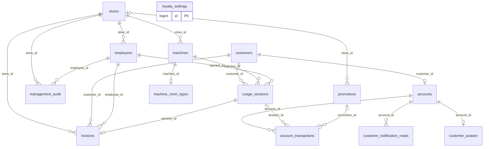
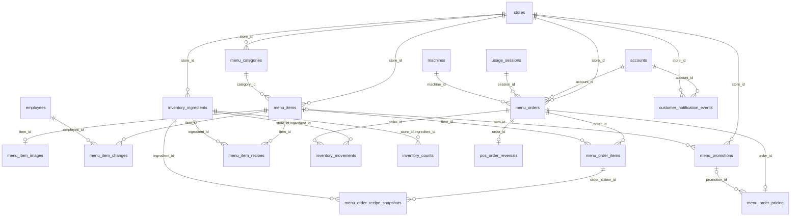
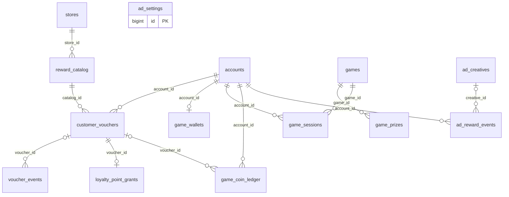
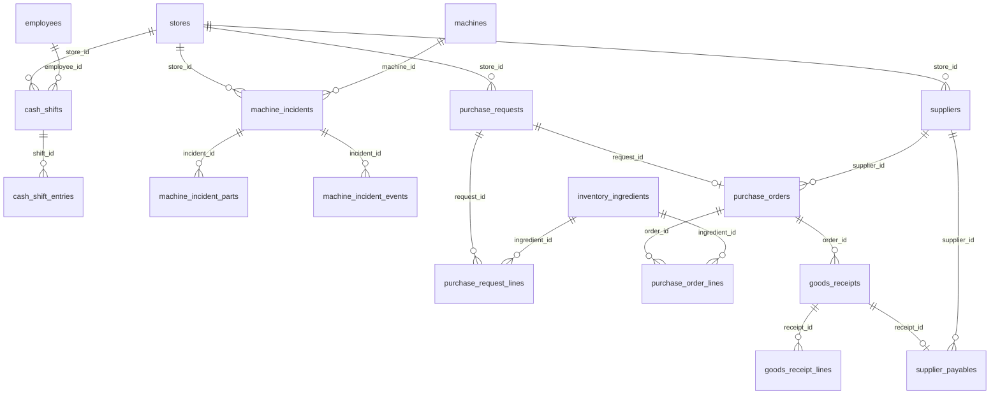
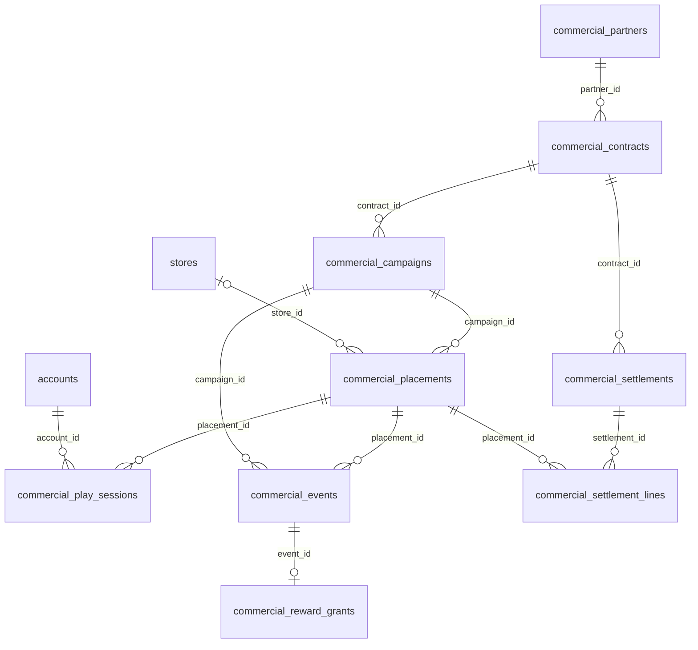
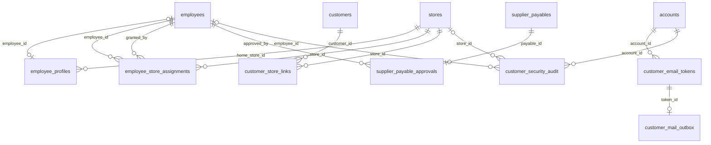

# ERD hiện hành — đối chiếu migration 001–027

Nguồn: `sql/001_initial_schema.sql` → `sql/027_customer_email_activation.sql`, theo thứ tự [runner](../../scripts/init_db.py). 70 bảng nghiệp vụ dưới đây đã được đối chiếu bằng [data dictionary](data_dictionary.md) sinh từ `INFORMATION_SCHEMA` của MySQL test. Bảng kỹ thuật `schema_migrations` do runner tạo riêng.

Mỗi quan hệ có tên **cột FK của bảng con** sau dấu `:`; đường liên kết không thay thế định nghĩa NULL, UNIQUE, `ON DELETE` hay CHECK trong SQL. Bảng độc lập có khối riêng. PK mặc định `id`, ngoại trừ các bảng liệt kê dưới đây. Dùng [data dictionary](data_dictionary.md) để xem kiểu cột, index và ràng buộc đầy đủ.

| Bảng | PK từ migration (các cột này cũng là FK nếu có quan hệ tương ứng trong sơ đồ) |
|---|---|
| `customer_avatars`, `game_wallets` | `account_id` |
| `machine_room_types` | `machine_id` |
| `menu_item_images` | `item_id` |
| `menu_order_pricing` | `order_id` |
| `customer_notification_reads` | `(account_id, notification_key)` |
| `menu_item_recipes` | `(item_id, ingredient_id)` |
| `menu_order_items` | `(order_id, item_id)` |
| `menu_order_recipe_snapshots` | `(order_id, item_id, ingredient_id)` |
| `purchase_request_lines` | `(request_id, ingredient_id)` |
| `purchase_order_lines` | `(order_id, ingredient_id)` |
| `goods_receipt_lines` | `(receipt_id, ingredient_id)` |
| `commercial_settlement_lines` | `(settlement_id, placement_id, event_type)` |
| `employee_store_assignments` | `(employee_id, store_id)` |
| `customer_store_links` | `(customer_id, store_id)` |
| `supplier_payable_approvals` | `payable_id` |

## Cửa hàng, định danh, phiên và tiền (14 bảng)

## Menu, đơn POS và kho (15 bảng)

## Voucher, game và quảng cáo nhận thưởng (12 bảng)

## Ca/két, bảo trì và mua hàng (13 bảng)

## Đối tác thương mại (9 bảng)

## RBAC theo cơ sở và email khách hàng (7 bảng mới ở migration 026–027)

Quan hệ còn lại (đặc biệt nhiều FK tới `employees`, `stores`, `accounts` và các FK nullable) xem trực tiếp SQL tương ứng. Các sơ đồ con tách theo nghiệp vụ để dễ đọc; một bảng có thể xuất hiện ở nhiều sơ đồ khi là bảng cha chung.
