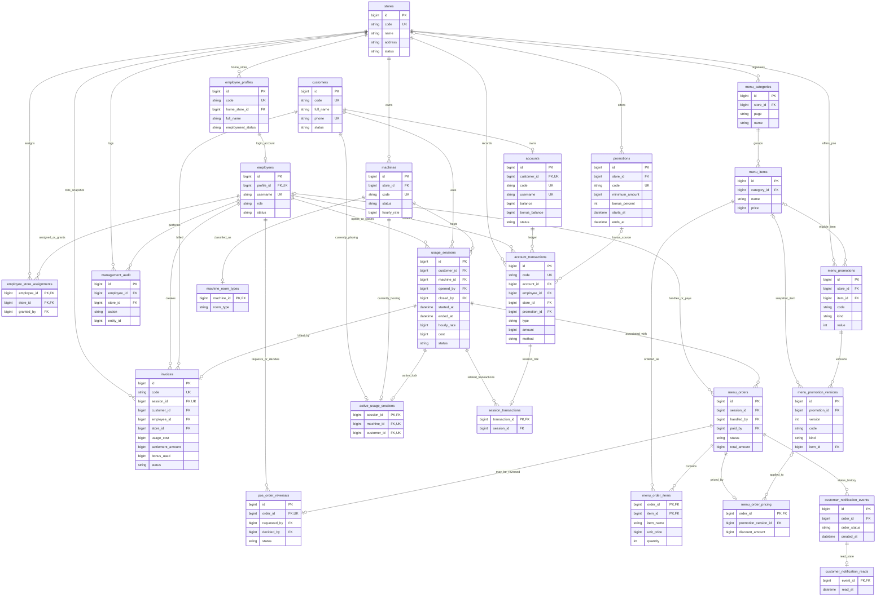

# Current ERD — 25 business tables

The current business schema contains **25 business tables**, **8 read views (`v_*`)**, **18 integrity triggers**, **46 foreign keys**, and **74 `CHECK` constraints** after migrations `001`–`011`. `schema_migrations` is technical metadata and is not counted.

Key 3NF highlights:
- `employee_profiles` owns HR metadata (`code`, `home_store_id`, `full_name`, `employment_status`); `employees.profile_id` (`UNIQUE`) owns the 1:0..1 link to login credentials.
- `active_usage_sessions` enforces at most one active session per `machine_id` and per `customer_id` via `UNIQUE` constraints without nullable flags or generated columns.
- `session_transactions` (migration `010`, tightened to `ON DELETE RESTRICT` + `BEFORE UPDATE` immutability in migration `011`) isolates session-linked ledger rows (`USAGE_PAYMENT`, `DEBT_SETTLEMENT`) from `account_transactions`.
- `menu_promotion_versions` stores immutable POS promotion snapshots referenced by `menu_order_pricing`.
