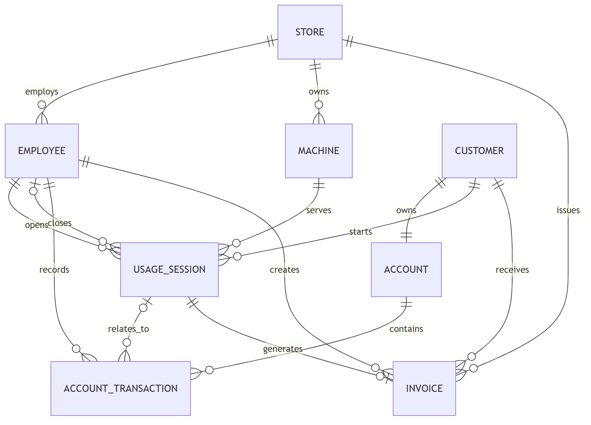
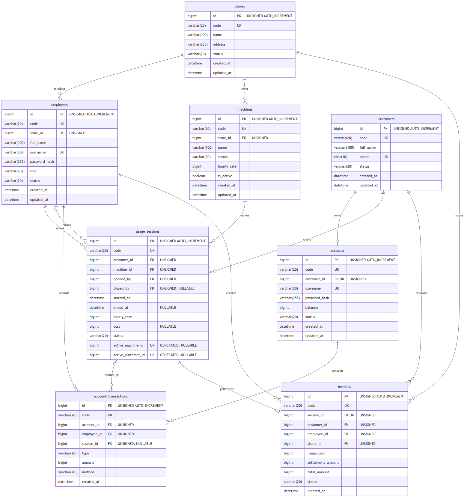

# Thiết kế cơ sở dữ liệu — CyberHub Manager

## 1. Mục tiêu

Thiết kế cơ sở dữ liệu được trình bày theo ba giai đoạn riêng biệt để phục vụ cả báo cáo và triển khai:

1. [Mô hình quan niệm](conceptual_erd.md) — xác định thực thể, quan hệ và cardinality từ yêu cầu nghiệp vụ.
2. [Mô hình logic và chuẩn hóa](logical_erd.md) — chuyển thực thể thành quan hệ, xác định thuộc tính, khóa và chuẩn hóa dữ liệu.
3. [Mô hình vật lý](physical_erd.md) — ánh xạ mô hình logic sang MySQL 8.4 với kiểu dữ liệu, ràng buộc và index.


## 2. Phạm vi P0

MVP gồm tám thực thể chính:

1. `stores` — cửa hàng.
2. `employees` — nhân viên quản lý hệ thống.
3. `customers` — thông tin khách hàng.
4. `accounts` — tài khoản và số dư khách hàng.
5. `machines` — máy tính thuộc cửa hàng.
6. `usage_sessions` — phiên sử dụng máy.
7. `account_transactions` — lịch sử thay đổi số dư.
8. `invoices` — hóa đơn kết thúc phiên.

`promotions`, `products`, `invoice_items`, `shifts`, `machine_groups` và `zones` nằm ngoài phạm vi P0.

## 3. Hình ERD cho báo cáo (HA-10)

| Hình | Nội dung | Nguồn |
|---|---|---|
|  | 8 thực thể, quan hệ và cardinality | [conceptual_erd.md](conceptual_erd.md) |
|  | Bảng MySQL với kiểu, PK/FK/UK | [physical_erd.md](physical_erd.md) |

Ảnh được render từ khối Mermaid trong hai file nguồn. Khi sửa sơ đồ, chép khối ```` ```mermaid ```` ra file
`erd_physical.mmd` (hoặc `erd_conceptual.mmd`) rồi xuất lại bằng [mermaid-cli](https://github.com/mermaid-js/mermaid-cli) (cần Node.js):

```powershell
npx -y @mermaid-js/mermaid-cli@11.4.2 -i erd_physical.mmd -o docs/diagrams/images/erd_physical.png -b white -s 2
```

## 4. Data dictionary

[data_dictionary.md](data_dictionary.md) liệt kê từng cột (kiểu, NULL, mặc định, PK/UK/FK, ý nghĩa), mọi
CHECK/UNIQUE/FOREIGN KEY, index và bảng cardinality của 14 khóa ngoại. File được **sinh từ schema MySQL thật**:

```powershell
python scripts/gen_data_dictionary.py           # ghi lại sau khi đổi schema
python scripts/gen_data_dictionary.py --check   # chỉ kiểm tra
```

Integration test `tests/integration/test_ha10_data_dictionary.py` fail nếu tài liệu lệch schema hoặc cột mới chưa có mô tả.

## 5. Tóm tắt cho báo cáo: chuẩn hóa và transaction

**Chuẩn hóa (chi tiết: [logical_erd.md §6](logical_erd.md#6-chuẩn-hóa-dữ-liệu)).** Mọi bảng đạt 3NF: giá trị nguyên tử (1NF),
khóa chính đơn `id` nên không có phụ thuộc bộ phận (2NF), thuộc tính không khóa chỉ phụ thuộc khóa chính (3NF) —
khách tách khỏi tài khoản, số dư chỉ nằm ở `accounts` còn lịch sử ở `account_transactions`. Ba chỗ **phi chuẩn hóa có chủ đích**:
`usage_sessions.hourly_rate` (chụp giá lúc mở phiên), `invoices.customer_id/employee_id/store_id` (giữ lịch sử, báo cáo nhanh)
và `invoices.total_amount` (snapshot tổng phí).

**Transaction (chi tiết: [physical_erd.md §13](physical_erd.md#13-transaction-và-toàn-vẹn-dữ-liệu)).** Mỗi nghiệp vụ ghi chạy trong
một transaction InnoDB, khóa dòng bằng `SELECT ... FOR UPDATE` theo thứ tự cố định máy → tài khoản → phiên; lỗi bất kỳ thì rollback
toàn bộ. Unique index trên cột sinh tự động `active_machine_id`/`active_customer_id` và `invoices.session_id` là lưới an toàn cuối
chống mở trùng phiên và thanh toán hai lần; deadlock được chạy lại tự động.

## 6. Artefact triển khai

- [`001_initial_schema.sql`](../../sql/001_initial_schema.sql) — tạo bảng và ràng buộc nền tảng.
- [`002_indexes.sql`](../../sql/002_indexes.sql) — index phục vụ truy vấn và unique index chống phiên hoạt động trùng.
- [`seed.sql`](../../sql/seed.sql) — dữ liệu demo, được thực hiện trong HA-03.

Mô hình quan niệm là nguồn giải thích nghiệp vụ; mô hình logic là nguồn mô tả cấu trúc dữ liệu; script SQL là nguồn triển khai cuối cùng. Khi thay đổi schema, phải cập nhật các tài liệu liên quan trong cùng pull request.
