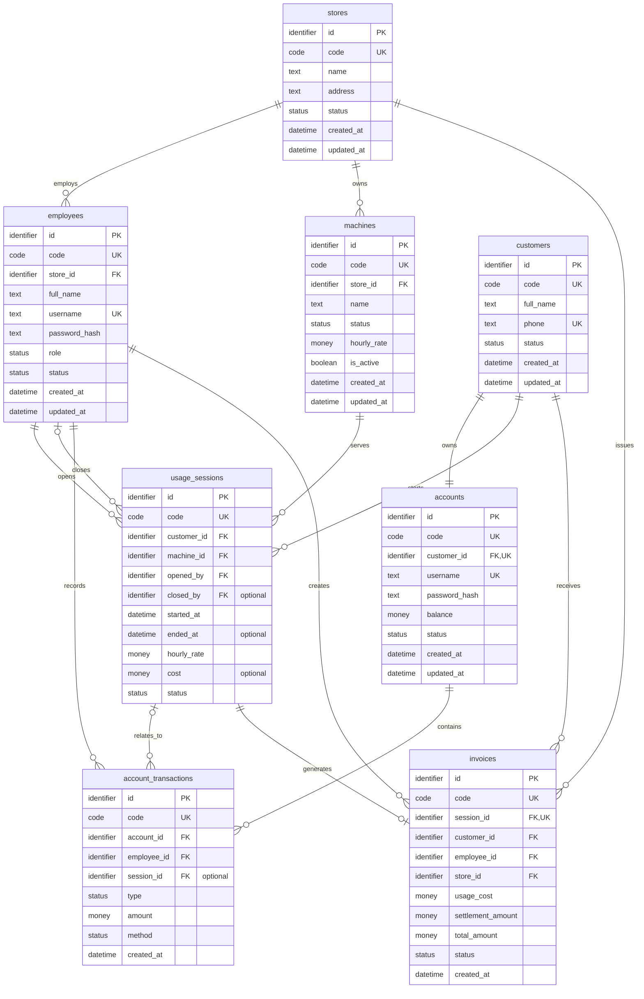

# Mô hình logic và chuẩn hóa

## 1. Mục tiêu

Mô hình logic chuyển các thực thể quan niệm thành các quan hệ có thuộc tính, khóa chính, khóa ngoại và khóa duy nhất. Phần này độc lập với kiểu dữ liệu cụ thể của MySQL.

## 2. Ánh xạ thực thể sang quan hệ

| Thực thể quan niệm | Quan hệ logic |
|---|---|
| `STORE` | `stores` |
| `EMPLOYEE` | `employees` |
| `CUSTOMER` | `customers` |
| `ACCOUNT` | `accounts` |
| `MACHINE` | `machines` |
| `USAGE_SESSION` | `usage_sessions` |
| `ACCOUNT_TRANSACTION` | `account_transactions` |
| `INVOICE` | `invoices` |

## 3. Lược đồ logic

Các kiểu `identifier`, `text`, `code`, `status`, `money`, `datetime` và `boolean` dưới đây là miền dữ liệu logic, chưa phải kiểu MySQL.

## 4. Miền giá trị

| Miền | Giá trị P0 |
|---|---|
| `Role` | `ADMIN`, `MANAGER`, `STAFF` |
| `StoreStatus` | `ACTIVE`, `INACTIVE` |
| `EmployeeStatus` | `ACTIVE`, `INACTIVE`, `LOCKED` |
| `CustomerStatus` | `ACTIVE`, `INACTIVE` |
| `AccountStatus` | `ACTIVE`, `LOCKED` |
| `MachineStatus` | `AVAILABLE`, `IN_USE`, `MAINTENANCE` |
| `SessionStatus` | `ACTIVE`, `COMPLETED`, `CANCELLED` |
| `TransactionType` | `TOP_UP`, `USAGE_PAYMENT`, `DEBT_SETTLEMENT`; `PROMOTION` dành cho P1 |
| `PaymentMethod` | `CASH`, `TRANSFER`, `ACCOUNT_BALANCE`; `PROMOTION` dành cho P1 |
| `InvoiceStatus` | `PAID`, `VOID` |

## 5. Thuộc tính tùy chọn

- `usage_sessions.closed_by`, `ended_at` và `cost` chưa có khi phiên đang `ACTIVE`.
- `account_transactions.session_id` không có đối với giao dịch nạp tiền độc lập.
- Các thuộc tính còn lại là bắt buộc trong P0, trừ khi physical schema ghi rõ ngoại lệ.

## 6. Chuẩn hóa dữ liệu

### 6.1. Dạng chuẩn 1 — 1NF

- Mỗi cột chứa một giá trị nguyên tử.
- Không lưu danh sách nhân viên, máy, phiên hoặc giao dịch trong một cột.
- Các tập dữ liệu lặp được tách thành quan hệ riêng.

### 6.2. Dạng chuẩn 2 — 2NF

- Mỗi quan hệ sử dụng một khóa chính đơn `id`.
- Mọi thuộc tính không khóa phụ thuộc đầy đủ vào khóa chính nên không có phụ thuộc bộ phận.

### 6.3. Dạng chuẩn 3 — 3NF

- Thông tin khách hàng và thông tin tài khoản được tách thành `customers` và `accounts`.
- Thông tin cửa hàng, nhân viên và máy không lặp lại trong `usage_sessions`.
- Số dư chỉ lưu trong `accounts`; lịch sử thay đổi số dư lưu trong `account_transactions`.
- Thông tin phiên và thông tin hóa đơn được tách để một phiên chỉ tạo tối đa một hóa đơn.

### 6.4. Phi chuẩn hóa có kiểm soát

- `usage_sessions.hourly_rate` là snapshot đơn giá lúc mở phiên; thay đổi giá máy không làm thay đổi lịch sử.
- `invoices.customer_id`, `employee_id` và `store_id` được giữ để truy vấn báo cáo và bảo toàn tham chiếu lịch sử.
- `invoices.total_amount` được giữ theo contract báo cáo. Trong P0, đây là snapshot tổng phí và bằng `usage_cost`; `settlement_amount` là phần phí được khách thanh toán bổ sung, không cộng lần thứ hai vào `total_amount`.

Các trường snapshot phải được service ghi trong cùng transaction và không được sửa sau khi hóa đơn đã `PAID`.

## 7. Ràng buộc logic chưa phụ thuộc DBMS

- Một khách hàng có đúng một tài khoản.
- Mã nghiệp vụ, username và số điện thoại phải duy nhất theo phạm vi đã xác định.
- Một máy và một khách hàng có tối đa một phiên `ACTIVE`.
- `hourly_rate` phải lớn hơn `0`; giao dịch phải có `amount` khác `0`.
- Phiên `ACTIVE` không có `closed_by`, `ended_at` hoặc `cost`.
- Phiên `COMPLETED` phải có `closed_by`, `ended_at` và `cost`.
- Hóa đơn có các khoản tiền không âm và chỉ được tạo một lần cho mỗi phiên.
