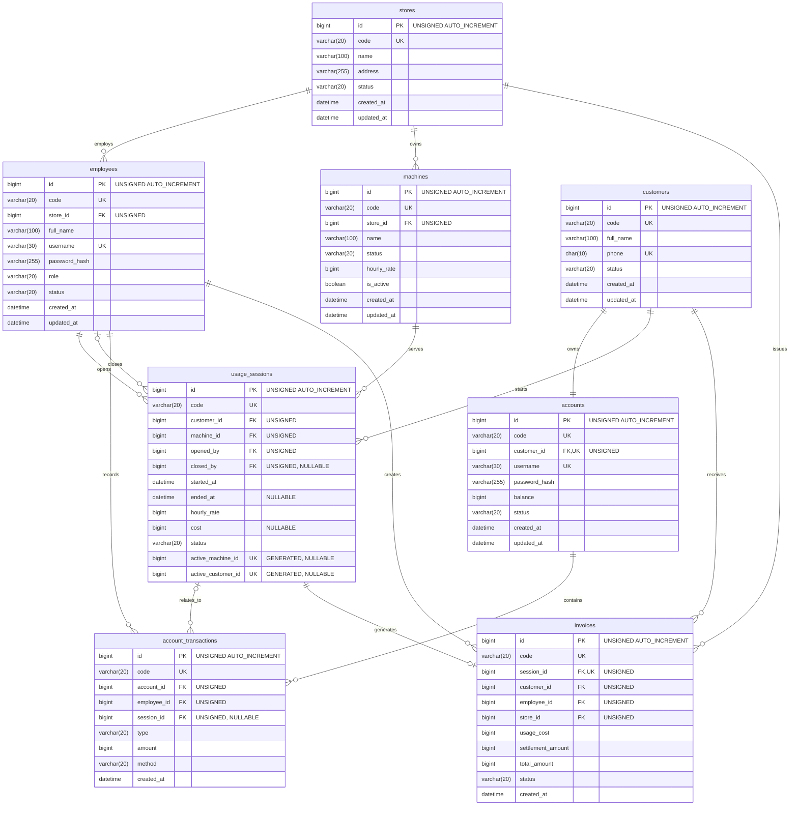

# Mô hình vật lý — MySQL 8.4

## 1. Phạm vi HA-02

ERD P0 gồm 8 bảng:

1. `stores` — cửa hàng
2. `employees` — nhân viên quản lý hệ thống
3. `customers` — thông tin khách hàng
4. `accounts` — tài khoản và số dư khách hàng
5. `machines` — máy tính thuộc cửa hàng
6. `usage_sessions` — phiên sử dụng máy
7. `account_transactions` — lịch sử thay đổi số dư
8. `invoices` — hóa đơn kết thúc phiên

`promotions` thuộc P1 nên chưa triển khai trong initial schema.

## 2. Quy ước chung

- Tên bảng và cột sử dụng tiếng Anh, dạng `snake_case`.
- ID sử dụng `BIGINT UNSIGNED AUTO_INCREMENT`.
- Tiền VND sử dụng `BIGINT`.
- Thời gian lưu bằng `DATETIME` theo UTC.
- Các bảng sử dụng `InnoDB`.
- Charset sử dụng `utf8mb4`.
- Dữ liệu lịch sử sử dụng `ON DELETE RESTRICT`.
- Không lưu mật khẩu dạng plain text, chỉ lưu `password_hash`.
- Không dùng `FLOAT` hoặc `DOUBLE` để lưu tiền.
- Không xóa cứng máy đã phát sinh phiên sử dụng.

## 3. Physical ERD



## 4. Giải thích cardinality

- Một cửa hàng có nhiều nhân viên và nhiều máy.
- Một khách hàng có đúng một tài khoản.
- Một khách hàng có thể có nhiều phiên sử dụng theo thời gian.
- Một máy có thể có nhiều phiên sử dụng theo thời gian.
- Mỗi phiên phải có một nhân viên mở phiên.
- Nhân viên đóng phiên có thể chưa tồn tại khi phiên đang hoạt động.
- Một tài khoản có nhiều giao dịch số dư.
- Một giao dịch có thể liên quan đến một phiên sử dụng.
- Một phiên chỉ được tạo tối đa một hóa đơn.
- Mỗi hóa đơn thuộc một khách hàng, cửa hàng và nhân viên thực hiện.

## 5. Quy tắc `stores` và `employees`

### `stores`

- `code` là duy nhất.
- `status` nhận `ACTIVE` hoặc `INACTIVE`.
- Cửa hàng `INACTIVE` không cho phép nhân viên đăng nhập hoặc mở phiên mới.

### `employees`

- `store_id` bắt buộc và tham chiếu `stores.id`.
- `code` và `username` là duy nhất.
- `role` nhận `ADMIN`, `MANAGER` hoặc `STAFF`.
- `status` nhận `ACTIVE`, `INACTIVE` hoặc `LOCKED`.
- `password_hash` chỉ lưu mật khẩu đã hash.
- Không trả `password_hash` ra UI hoặc DTO.

## 6. Quy tắc `customers` và `accounts`

### `customers`

- `code` và `phone` là duy nhất.
- `full_name` dài từ 2 đến 100 ký tự.
- `phone` gồm 10 chữ số và bắt đầu bằng `0`.
- `status` nhận `ACTIVE` hoặc `INACTIVE`.
- Không xóa cứng khách hàng đã có lịch sử giao dịch hoặc phiên sử dụng.

### `accounts`

- Mỗi khách hàng có đúng một tài khoản.
- `customer_id` vừa là khóa ngoại vừa có ràng buộc là `UNIQUE`.
- `code` và `username` là duy nhất.
- `username` dài từ 4 đến 30 ký tự, gồm chữ, số, `_` và `.`.
- `balance` sử dụng `BIGINT`, đơn vị VND và mặc định bằng `0`.
- Số dư có thể âm khi khách hàng đang sử dụng máy.
- `status` nhận `ACTIVE` hoặc `LOCKED`.
- `password_hash` không được trả ra UI hoặc DTO.
- Số dư chỉ được thay đổi thông qua nghiệp vụ có ghi `account_transactions`.

## 7. Quy tắc `account_transactions`

- `code` là duy nhất.
- `account_id` tham chiếu `accounts.id`.
- `employee_id` lưu nhân viên thực hiện giao dịch.
- `session_id` có thể `NULL` đối với giao dịch nạp tiền độc lập.
- `amount` sử dụng `BIGINT`, có dấu và phải khác `0`.
- `TOP_UP`, `PROMOTION` và `DEBT_SETTLEMENT` có `amount > 0`.
- `USAGE_PAYMENT` có `amount < 0`.
- `type` nhận một trong các giá trị:
  - `TOP_UP`
  - `PROMOTION`
  - `USAGE_PAYMENT`
  - `DEBT_SETTLEMENT`
- `method` nhận một trong các giá trị:
  - `CASH`
  - `TRANSFER`
  - `ACCOUNT_BALANCE`
  - `PROMOTION`
- Mọi thay đổi số dư phải có một bản ghi tương ứng trong bảng này.
- Không cập nhật hoặc xóa giao dịch đã hoàn thành.

## 8. Quy tắc `invoices`

- `code` là duy nhất.
- `session_id` vừa là khóa ngoại vừa có ràng buộc `UNIQUE`.
- Mỗi phiên chỉ được tạo tối đa một hóa đơn.
- `customer_id`, `employee_id` và `store_id` được lưu để bảo toàn lịch sử.
- `usage_cost`, `settlement_amount` và `total_amount` sử dụng `BIGINT`.
- Các trường tiền trên hóa đơn không được âm.
- `settlement_amount` mặc định bằng `0`.
- Trong P0, `total_amount = usage_cost`; `settlement_amount` là phần phí được khách thanh toán bổ sung và không cộng lần thứ hai.
- `status` nhận `PAID` hoặc `VOID`.
- Hóa đơn `PAID` không được xóa cứng.
- Doanh thu ngày được tính từ tổng `usage_cost` của hóa đơn `PAID`.
- `created_at` lưu theo UTC.

## 9. Quy tắc `machines`

- `code` là duy nhất.
- `store_id` bắt buộc và tham chiếu `stores.id`.
- `name` có độ dài tối đa 100 ký tự.
- `hourly_rate` sử dụng `BIGINT`, đơn vị VND và phải lớn hơn `0`.
- `status` nhận một trong ba giá trị:
  - `AVAILABLE`
  - `IN_USE`
  - `MAINTENANCE`
- Chỉ máy `AVAILABLE` và `is_active = TRUE` mới được mở phiên.
- Máy đang `IN_USE` không được chuyển sang `MAINTENANCE`.
- Máy chưa có lịch sử có thể xóa cứng.
- Máy đã có lịch sử chỉ được archive bằng cách đặt `is_active = FALSE`.
- Khi thay đổi `hourly_rate`, phiên đang chạy không bị thay đổi đơn giá vì đơn giá đã được snapshot vào `usage_sessions`.

## 10. Quy tắc `usage_sessions`

- `code` là duy nhất.
- `customer_id` tham chiếu `customers.id`.
- `machine_id` tham chiếu `machines.id`.
- `opened_by` tham chiếu nhân viên mở phiên.
- `closed_by` có thể `NULL` khi phiên chưa kết thúc.
- `started_at` lưu thời điểm bắt đầu theo UTC.
- `ended_at` có thể `NULL` khi phiên đang hoạt động.
- `hourly_rate` là snapshot đơn giá của máy tại thời điểm mở phiên.
- `cost` có thể `NULL` khi phiên đang hoạt động.
- `status` nhận một trong các giá trị:
  - `ACTIVE`
  - `COMPLETED`
  - `CANCELLED`
- Phiên `ACTIVE` phải có `ended_at`, `closed_by` và `cost` bằng `NULL`.
- Phiên `COMPLETED` phải có `ended_at`, `closed_by` và `cost`.
- `active_machine_id` và `active_customer_id` là generated columns phục vụ ràng buộc database.
- Hai generated columns không thuộc Domain Model hoặc DTO.

Generated expression dự kiến:

```sql
active_machine_id BIGINT UNSIGNED
    GENERATED ALWAYS AS (
        CASE WHEN status = 'ACTIVE' THEN machine_id ELSE NULL END
    ) STORED

active_customer_id BIGINT UNSIGNED
    GENERATED ALWAYS AS (
        CASE WHEN status = 'ACTIVE' THEN customer_id ELSE NULL END
    ) STORED
```

Unique index trên hai cột này bảo đảm mỗi máy và mỗi khách hàng chỉ có tối đa một phiên `ACTIVE`. Các phiên đã kết thúc trả về `NULL` nên không xung đột trong unique index.

## 11. Ngoài phạm vi MVP

Các bảng sau được xem xét cho phiên bản sau và không thuộc `001_initial_schema.sql`:

- `products`, `invoice_items`: bán đồ ăn, nước uống và dịch vụ bổ sung.
- `shifts`: quản lý ca làm việc và đối soát tiền mặt.
- `machine_groups`, `zones`: phân nhóm máy và áp dụng biểu giá theo khu vực.

## 12. Index plan

Ngoài primary key và unique key thể hiện trên ERD, physical schema cần các index sau:

| Bảng | Index | Mục đích |
|---|---|---|
| `employees` | `(store_id, status)` | Đăng nhập và lọc nhân viên theo cửa hàng |
| `machines` | `(store_id, is_active, status)` | Dashboard máy theo cửa hàng |
| `usage_sessions` | `(machine_id, started_at)` | Lịch sử phiên của máy |
| `usage_sessions` | `(customer_id, started_at)` | Lịch sử phiên của khách |
| `usage_sessions` | `(status, started_at)` | Tìm phiên đang hoạt động |
| `account_transactions` | `(account_id, created_at)` | Lịch sử thay đổi số dư |
| `invoices` | `(store_id, status, created_at)` | Doanh thu theo cửa hàng và ngày |
| `invoices` | `(customer_id, created_at)` | Tra cứu hóa đơn theo khách |
| `usage_sessions` | `UNIQUE(active_machine_id)` | Chống mở trùng máy |
| `usage_sessions` | `UNIQUE(active_customer_id)` | Chống khách mở nhiều phiên |

Index plan sẽ được kiểm chứng bằng `EXPLAIN` trong HA-09; không tạo index trùng với index do primary key hoặc unique constraint đã sinh.

## 13. Transaction và toàn vẹn dữ liệu

- Nạp tiền khóa account bằng `SELECT ... FOR UPDATE`, cập nhật số dư và ghi giao dịch trong cùng transaction.
- Mở phiên khóa account và machine; tạo phiên rồi chuyển máy sang `IN_USE` trong cùng transaction.
- Checkout khóa account, machine và active session; ghi giao dịch, đóng phiên, trả máy về `AVAILABLE` và tạo hóa đơn trong cùng transaction.
- Repository không tự commit; service điều phối `BEGIN`, `COMMIT` và `ROLLBACK`.
- Credential được đọc từ environment và không xuất hiện trong script SQL hoặc tài liệu.

## 14. Artefact cài đặt

- [`001_initial_schema.sql`](../../sql/001_initial_schema.sql) tạo bảng, foreign key, check constraint và default value.
- [`002_indexes.sql`](../../sql/002_indexes.sql) tạo index thường và unique index trên generated columns.
- [`seed.sql`](../../sql/seed.sql) thuộc HA-03, không thuộc thiết kế vật lý HA-02.
