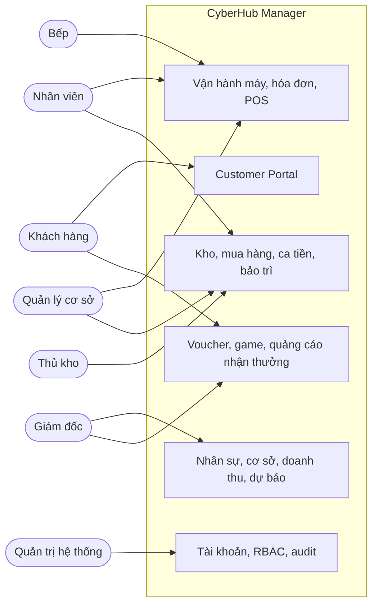
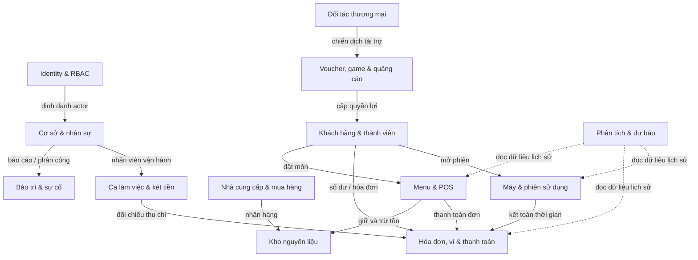
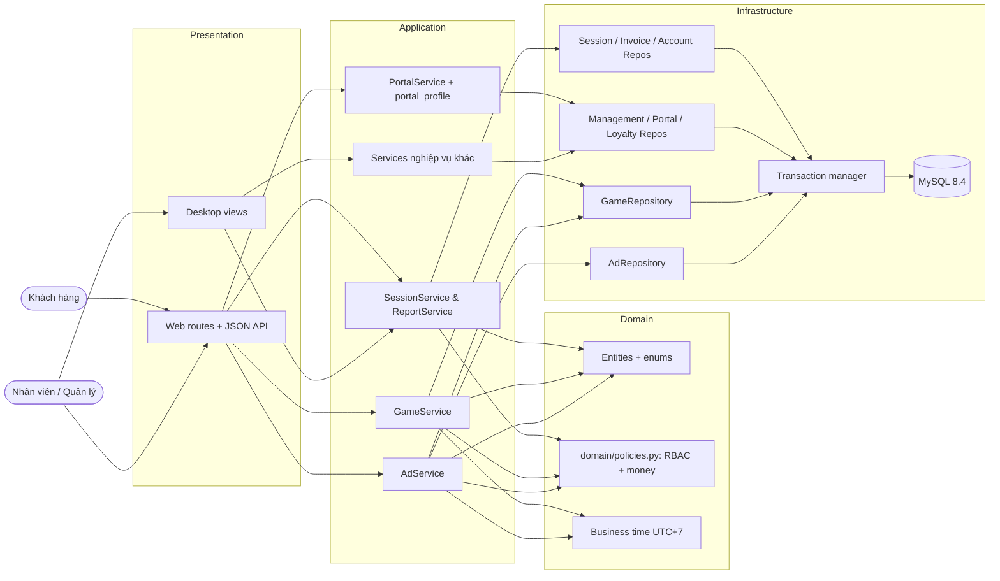
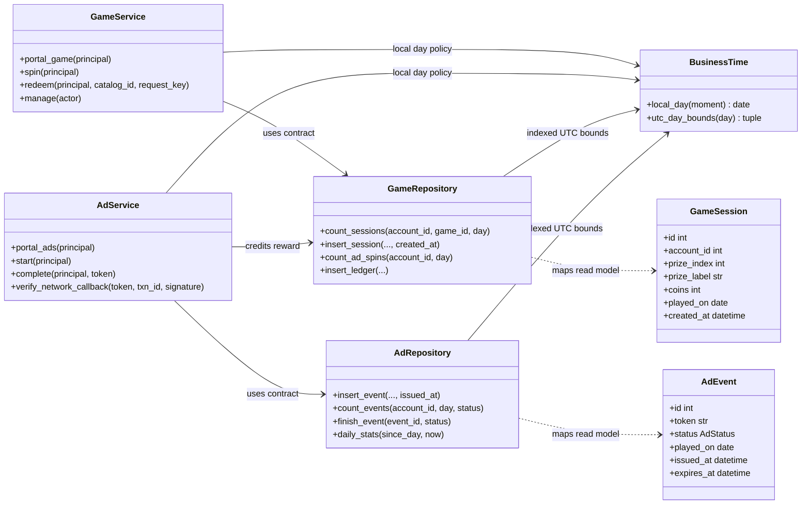
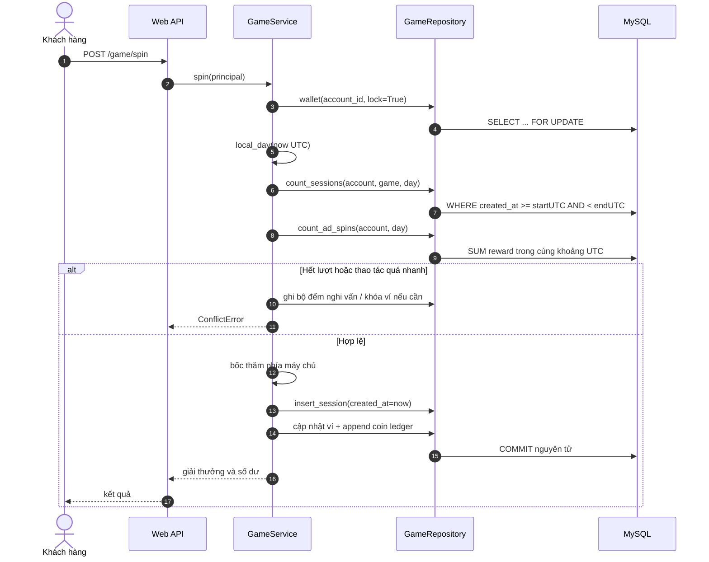
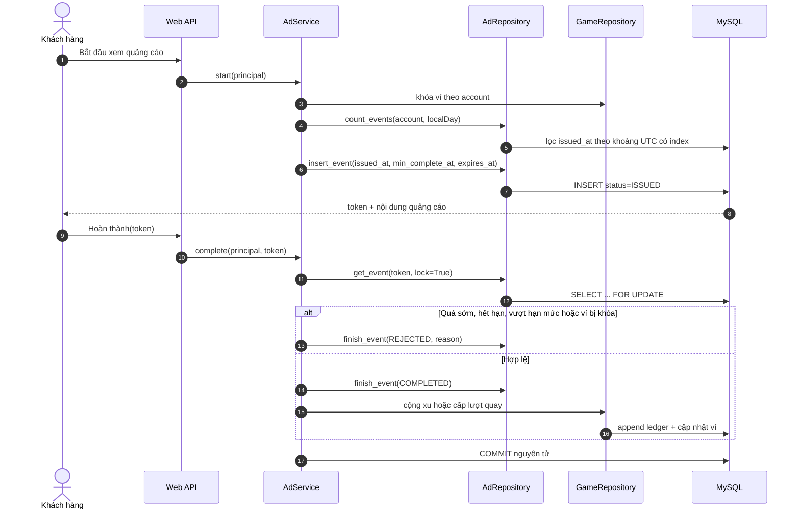
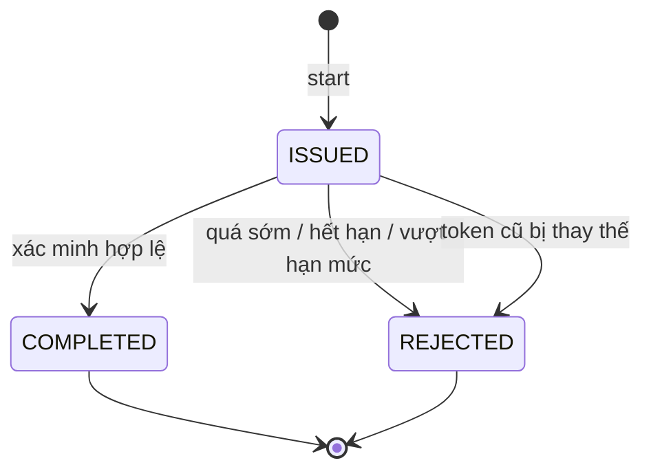

# UML hệ thống CyberHub Manager

Tài liệu này mô tả cấu trúc source bốn tầng và các luồng nghiệp vụ trọng tâm sau migration `032` (75 bảng nghiệp vụ, 18 view đọc, 28 trigger).
ERD đầy đủ nằm tại [current_erd.md](current_erd.md); kiểu cột và ràng buộc vật lý nằm tại
[data_dictionary.md](data_dictionary.md). Các sơ đồ Mermaid có thể xem trực tiếp trên GitHub.

## 1. System context — tác nhân và năng lực hiện có

Sơ đồ thể hiện **phạm vi năng lực**, không thay thế ma trận quyền. Quyền chi tiết và giới hạn theo cơ sở
nằm tại [RBAC_PERMISSION_MATRIX.md](../RBAC_PERMISSION_MATRIX.md); backend vẫn kiểm tra quyền ở từng use case.

## 2. Domain map — ranh giới nghiệp vụ

Mũi tên nét liền là phụ thuộc nghiệp vụ khi thực hiện giao dịch. Mũi tên nét đứt là luồng đọc phục vụ
phân tích; module dự báo không ghi ngược vào dữ liệu giao dịch.

## 3. Component diagram — kiến trúc bốn tầng

Quy tắc phụ thuộc hiện hành: Presentation gọi Application; Application dùng Domain và repository/adapter
Infrastructure; Infrastructure truy cập MySQL và provider kỹ thuật. Domain không phụ thuộc Flask, Tkinter,
Application hay MySQL. Đây là layered architecture bốn tầng của source hiện tại, không mô tả sai thành
Clean Architecture với repository port chưa tồn tại.

## 4. Class diagram — game và quảng cáo nhận thưởng

`played_on` trong hai read model là dữ liệu trình bày được suy ra. Hai bảng cơ sở chỉ lưu
`created_at` hoặc `issued_at`, vì vậy không còn FD `timestamp → played_on` bên trong quan hệ.

## 5. Sequence diagram — quay thưởng an toàn

## 6. Sequence và state diagram — quảng cáo nhận thưởng

## 7. Quy tắc dữ liệu sau migration `031`–`032`

- Timestamp trong bảng cơ sở là nguồn sự thật và được lưu theo UTC (`031`); ngày nghiệp vụ là `DATE(timestamp + INTERVAL 7 HOUR)` trong read model và truy vấn đếm theo ngày dùng khoảng UTC nửa mở có index.
- Sổ cái ví `account_transactions` luôn gắn `store_id NOT NULL` và tách liên kết phiên tùy chọn sang bảng 1–1 `session_transactions(transaction_id PK, session_id)` (`032`), loại bỏ cột `session_id` nullable/thưa trên sổ cái.
- Hai bảng sổ cái cốt lõi (`account_transactions`, `inventory_movements`) được bảo vệ bất biến (append-only) ở mức trigger MySQL (`BEFORE UPDATE` / `BEFORE DELETE` phát `SQLSTATE '45000'`).
- Giới hạn lượt, cập nhật ví, hủy phiên (`CANCELLED`), hủy hóa đơn (`VOID`) và ghi ledger đều chạy trong cùng transaction có khóa hàng `FOR UPDATE`.
