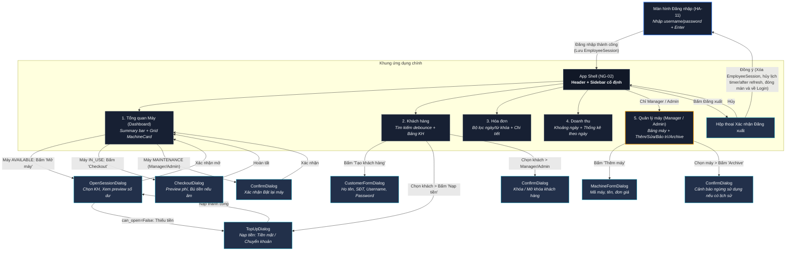

# UI Wireflow — CyberHub Manager

Tài liệu thiết kế luồng điều hướng màn hình và ma trận phân quyền giao diện cho CyberHub Manager (Nhiệm vụ NG-01).
Căn cứ quy chuẩn: `docs/03_UI_THEME.md`, `docs/07_DTO_UI_HANDOFF.md` và `docs/assignments/NGAT_NG01.md`.

---

## 1. Sơ đồ luồng điều hướng tổng thể (Navigation Wireflow)

---

## 2. Chi tiết cấu trúc App Shell

### 2.1. Thanh điều hướng bên trái (Sidebar)
Thứ tự menu cố định từ trên xuống dưới (độ rộng 224 px, nền `#111827`):
1. **Tổng quan (Dashboard):** Xem lưới máy live, mở máy, checkout máy.
2. **Khách hàng:** Tìm kiếm khách hàng, xem số dư, nạp ví, khóa tài khoản.
3. **Hóa đơn:** Tra cứu hóa đơn theo ngày, trạng thái, xem chi tiết giờ chơi.
4. **Doanh thu:** Báo cáo doanh thu tiền giờ theo ngày tại cửa hàng.
5. **Quản lý máy:** *(Chỉ hiển thị với vai trò `MANAGER` hoặc `ADMIN`)* Thêm máy mới, đổi đơn giá, bảo trì, ngừng sử dụng.
6. **Đăng xuất:** Nút cố định ở góc dưới cùng của Sidebar.

### 2.2. Thanh tiêu đề trên cùng (Header)
- **Bên trái:** Tên màn hình hiện tại + Breadcrumb.
- **Bên phải:** Tên cửa hàng (`store_name`), Họ tên nhân viên (`full_name`), và `StatusBadge` vai trò (`STAFF` / `MANAGER` / `ADMIN`).

---

## 3. Ma trận phân quyền chi tiết (Permissions Matrix)

| Chức năng / Thao tác | STAFF (Nhân viên) | MANAGER (Quản lý) | ADMIN (Quản trị viên) | Hành vi UI khi không có quyền |
|---|:---:|:---:|:---:|---|
| **Xem Dashboard máy** | Có | Có | Có | Cho phép |
| **Mở phiên sử dụng máy** | Có | Có | Có | Cho phép |
| **Checkout phiên sử dụng** | Có | Có | Có | Cho phép |
| **Bật lại máy đang bảo trì** | ❌ Không | Có | Có | STAFF chỉ thấy nhãn "Đang bảo trì", không có nút |
| **Nạp tiền vào tài khoản khách** | Có | Có | Có | Cho phép |
| **Tạo tài khoản khách hàng mới** | Có | Có | Có | Cho phép |
| **Sửa thông tin khách hàng** | Có | Có | Có | Cho phép |
| **Khóa / Mở khóa khách hàng** | ❌ Không | Có | Có | Ẩn nút "Khóa/Mở khóa" trên màn hình khách hàng |
| **Xem Hóa đơn & Doanh thu** | Có *(store hiện tại)* | Có *(store hiện tại)* | Có *(store hiện tại)* | Xem dữ liệu trong phạm vi cửa hàng |
| **Menu "Quản lý máy"** | ❌ Không | Có | Có | **Ẩn hoàn toàn** mục menu trên Sidebar |
| **Thêm / Sửa máy tính** | ❌ Không | Có | Có | Không truy cập được menu |
| **Chuyển máy sang bảo trì** | ❌ Không | Có | Có | Không truy cập được menu |
| **Ngừng sử dụng / Xóa máy (Archive)** | ❌ Không | Có | Có | Không truy cập được menu |

---

## 4. Đặc tả luồng xử lý Dialog quan trọng

> [!NOTE]
> Chữ ký hàm dưới đây tuân thủ hợp đồng dịch vụ chính thức tại `src/cyberhub_manager/services/contracts.py`.
> Mọi thao tác UI phải truyền đúng và đủ tham số ngữ cảnh (actor/employee_id, machine_id, customer_id).

### 4.1. Mở phiên (Open Session Flow)
1. Nhân viên bấm **"Mở máy"** trên một Card máy `AVAILABLE`.
2. Mở `OpenSessionDialog`:
   - Hiển thị tên máy và đơn giá hiện tại.
   - Nhập tìm kiếm khách hàng (debounce 300 ms) hoặc chọn từ danh sách.
   - Gọi `preview_open(customer_id, machine_id, actor)`:
     - Hiển thị số dư hiện tại, số dư tối thiểu yêu cầu, thời gian chơi ước tính.
     - Nếu `can_open == False`: Nút "Xác nhận mở phiên" bị disable; hiển thị thông báo lý do (`blocked_reason`) kèm nút kêu gọi hành động (CTA) **"Nạp tiền ngay"**.
3. Bấm **"Xác nhận mở"**: Nút chuyển sang trạng thái `busy` (`set_busy(True)` hiển thị `"Processing…"`), gọi `open_session(customer_id, machine_id, actor)`, đóng dialog và tự động refresh Dashboard. Thoát busy trong khối `finally: set_busy(False)`.

### 4.2. Kết thúc phiên (Checkout Flow)
1. Nhân viên bấm **"Checkout"** trên một Card máy `IN_USE`.
2. Mở `CheckoutDialog`:
   - Tự động gọi `preview_checkout(machine_id, current_time)`:
   - Hiển thị: Thời gian bắt đầu, thời gian kết thúc, tổng số phút tính tiền, đơn giá snapshot, tổng tiền sử dụng.
   - Số dư dự kiến (`projected_balance`):
     - **Nếu `projected_balance >= 0`**: Tiền sử dụng được trừ tự động vào tài khoản; tiền khách bù = 0; phương thức thanh toán = `None`.
     - **Nếu `projected_balance < 0`**: Hiển thị khung cảnh báo đỏ `DANGER`; hiển thị ô bắt buộc nhập tiền bù (`settlement_amount >= settlement_required`) và chọn phương thức (`CASH` hoặc `TRANSFER`).
3. Nhân viên bấm **"Hoàn tất Checkout"**: Nút chuyển sang `busy` (`"Processing…"`), gọi `complete_checkout(machine_id, actor, settlement_amount, method)`, hiển thị tóm tắt biên lai (Receipt Summary), và refresh Dashboard. Thoát busy trong `finally`.

### 4.3. Nạp tiền tài khoản (Top-Up Flow)
1. Nhân viên bấm **"Nạp tiền"** từ danh sách khách hàng hoặc từ CTA trong OpenSessionDialog.
2. Mở `TopUpDialog`:
   - Hiển thị tên khách hàng, số dư hiện tại.
   - Ô nhập số tiền cần nạp (chỉ nhận số nguyên, tự động format `VND` khi mất focus).
   - Chọn phương thức: `Tiền mặt (CASH)` hoặc `Chuyển khoản (TRANSFER)`.
3. Bấm **"Xác nhận nạp"**: Gọi `top_up(customer_id, amount, method, employee_id)` với `employee_id = actor.employee_id`, hiển thị Toast thành công bằng tiếng Anh (`"Operation completed successfully."`) và cập nhật số dư mới trên giao diện.

### 4.4. Đăng xuất an toàn (Safe Logout Flow)
1. Người dùng bấm **"Đăng xuất"** trên Sidebar.
2. Hiển thị `ConfirmDialog.ask(parent, title="Confirm Logout", message="Are you sure you want to log out?")`.
3. Khi người dùng xác nhận:
   - Hủy bỏ và dọn dẹp các lịch trình cập nhật ngầm (`after_cancel` trên các polling timers).
   - Xóa `EmployeeSession` khỏi ứng dụng (đảm bảo không còn lưu trữ token/quyền trong RAM).
   - Đóng toàn bộ cửa sổ chính `AppShell` và chuyển hướng về màn hình `LoginView`.

---

## 5. Quy tắc xử lý ngoại lệ nghiệp vụ trên UI (Exception Handling)

Toàn bộ thông báo phản hồi hiển thị cho người dùng (Toast, dialog, field error) sử dụng **tiếng Anh nhất quán** theo quy chuẩn NG01-08:

| Ngoại lệ từ Service | Trạng thái / Code | Cách UI hiển thị tương ứng |
|---|---|---|
| `ValidationError` | `VALIDATION_ERROR` | Gắn thông báo lỗi viền đỏ `DANGER` vào đúng `FormField` qua `set_error("Invalid data provided. Please check the highlighted fields.")`; giữ nguyên dữ liệu đã nhập. |
| `AuthenticationError` | `AUTH_INVALID_CREDENTIALS` | Giữ nguyên username, xóa sạch mật khẩu, hiển thị thông báo lỗi `Invalid username or password`. |
| `NotFoundError` | `NOT_FOUND` | Hiển thị Toast cảnh báo `Requested resource was not found.`; tự động refresh tải lại danh sách. |
| `ConflictError` | `CONFLICT` | Mở warning dialog `Operation conflict. Another transaction or update may have occurred.`; giữ nguyên dữ liệu form để người dùng kiểm tra hoặc đổi giá trị. |
| `PermissionDeniedError` | `PERMISSION_DENIED` | Hiển thị Toast cảnh báo `You do not have permission to perform this action.`; không thực thi thao tác. |
| `InsufficientBalanceError` | `INSUFFICIENT_BALANCE` | Giữ dialog mở phiên, tải lại preview mới nhất, hiện Toast `Insufficient balance to perform this operation.` kèm CTA nạp tiền. |
| `SettlementRequiredError` | `SETTLEMENT_REQUIRED` | Giữ dialog checkout, tải lại preview mới, hiện thông báo `Outstanding balance settlement is required before proceeding.` và focus con trỏ vào ô nhập tiền bù. |
| `ServiceUnavailableError` | `SERVICE_UNAVAILABLE` | Chuyển bảng sang `ViewState.ERROR`, hiển thị thông điệp `Unable to load data` kèm nút `Retry`. |

---

## 6. Hướng dẫn bàn giao cho NG-02 và HA-11
- **Hoàng Anh (HA-11 — Login UI):**
  - Sử dụng các token màu và font từ `cyberhub_manager.ui.theme`.
  - Sử dụng `FormField(label="Tên đăng nhập")`, `FormField(label="Mật khẩu", is_password=True)`.
  - Sử dụng `ActionButton(text="Đăng nhập", kind="primary")` với cơ chế `set_busy` khi gọi `login()`.
- **Ngát (NG-02 & NG-03 — App Shell & Dashboard):**
  - Sử dụng cấu trúc menu Sidebar và Header theo đúng mục 2 của tài liệu này.
  - Sử dụng `MachineCard` đã đóng gói tại `cyberhub_manager.ui.components` cho lưới Dashboard máy.
